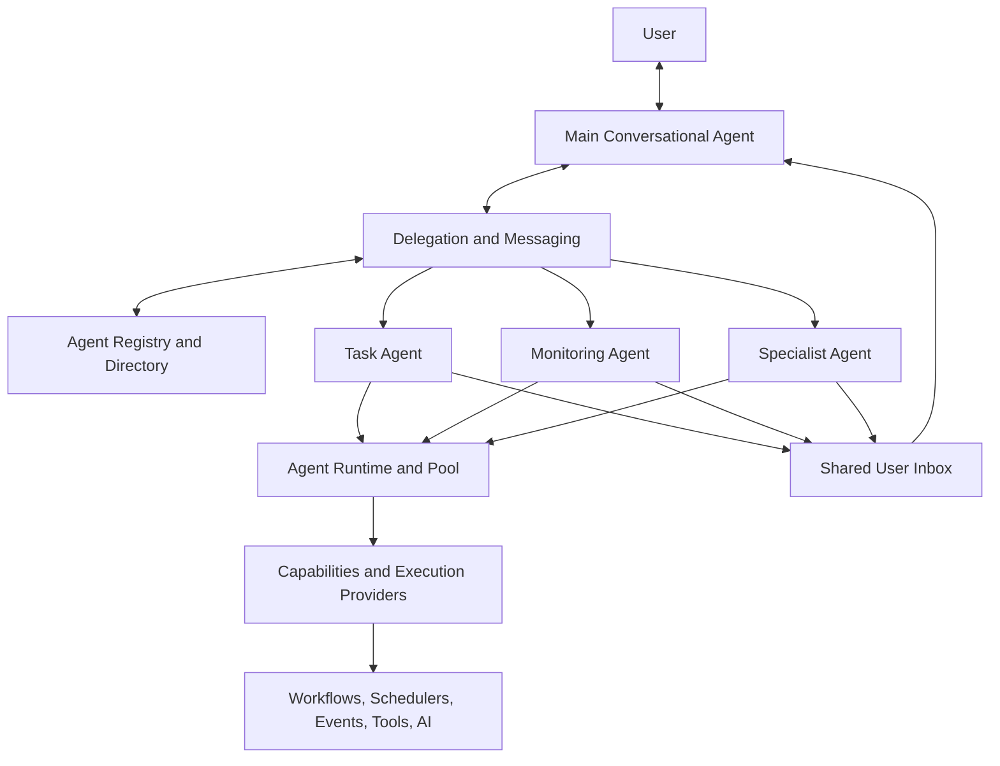

# Agentropy

**Composable, capability-driven multi-agent framework for reliable autonomous work.**

Agentropy models agents as reusable definitions with configurable capability profiles, independent logical identities and lifecycles, and pluggable execution backends. It supports conversational, task-oriented, monitoring, and coordinating agents, with visible delegation and a unified user experience.

> **Project stage:** Architecture and design baseline. This repository does not yet contain a working framework. Designs and proposed interfaces are subject to validation through implementation.

## Why Agentropy?

An AI assistant can delegate an objective to a specialized agent that works across conversation sessions, uses scheduled or event-driven execution, invokes tools and deterministic workflows, and reports meaningful progress or results. Users interact primarily through one conversational assistant, while optionally seeing agents and their assignments.

Agentropy separates **multi-agent collaboration (the user-facing model)** from **workflow and runtime execution (implementation mechanisms)**. A workflow can power an agent; an agent does not have to run an LLM continuously. Agentropy aims to provide consistent identity, capability, delegation, reliability, and governance contracts, rather than build another general-purpose workflow engine.

## Core model

- **Agent definition:** Versioned specification of identity, role/profile, required/default/optional capabilities, policies and runtime requirements.
- **Agent instance:** Logical, owned, persistent agent identity created from a definition; independent of any single process.
- **Delegated task:** A bounded objective assigned to an agent, with its own status, ownership, audit trail, and reporting.
- **Execution:** An individual attempt or continuation of work. A task may involve multiple executions; a process/worker is not an agent identity.
- **Agent profile:** Reusable capability bundle (e.g. Conversational, Task, Monitoring, Coordinator, Specialist) with required, default, and optional capabilities.
- **Capabilities:** Composable behaviors and guarantees, with explicit contracts, policies and provider dependencies. Durability is a runtime guarantee, while autonomy is a constrained decision policy.
- **Registry:** Discovery of definitions and capabilities; separately tracks logical instances.
- **Pool:** Capacity, scheduling and leases of physical execution resources; always-on agents need not permanently occupy workers.
- **Runtime:** Lifecycle transitions, execution, checkpointing, resumption and recovery through pluggable providers.
- **Inbox:** Durable progress, outcome, approval and notification records; the main assistant communicates with the user according to preferences and importance.

## Conceptual architecture

Definitions, instances, tasks, and executions are separate persisted concepts. Delegations and results cross agent boundaries through explicit, authorized messages. The diagram is logical; components do not each require their own service.

## Initial profiles

| Profile | Required or default behaviors (initial proposal) | Optional additions |
|---|---|---|
| Conversational | Conversation, session context, inbound messages | Delegation, durable memory, tools |
| Task | Task execution, durable state/recovery, event handling | Scheduling, workflow, AI planning |
| Monitoring | Monitoring, durable state, event handling | Scheduling, alerts, delegation |
| Coordinator | Delegation, message correlation, task tracking | Conversation, durability, workflow |
| Specialist | Domain tools and execution contract | Memory, conversation, durability |

Profiles are templates, not a rigid inheritance hierarchy. Required capabilities are enforced; defaults may be overridden. A Task Agent need not be scheduled: scheduling is supported when needed.

## Non-goals (initial scope)

- Replacing Temporal, LangGraph, Quarkus Flow, or another workflow/agent runtime.
- Treating every workflow as an LLM agent, or requiring continuous model inference for always-on behavior.
- Enforcing a single framework, vendor, language, UI, transport, or cloud provider.
- Building a centralized distributed orchestration platform in the first milestone.

## Documentation

- [Vision and scope](docs/vision.md)
- [Requirements](docs/requirements.md)
- [Architectural reuse assessment from langgraph-flows](docs/reuse-from-langgraph-flows.md)
- [Task lifecycle and version compatibility](docs/runtime-contract.md)
- [Agent messaging contracts](docs/messaging-contract.md)
- [Human actions and proactive priority](docs/human-actions.md)
- [Architecture](docs/architecture.md)
- [Domain model](docs/domain-model.md)
- [Capabilities and profiles](docs/capabilities.md)
- [Registry, pool and runtime](docs/registry-runtime.md)
- [Delegation, inbox and user experience](docs/collaboration.md)
- [Security, reliability and operability](docs/operations.md)
- [Architecture decision records](docs/adr/README.md)
- [Roadmap and implementation tasks](TODO.md)
- [Change log](CHANGELOG.md)

## Cross-project design reuse

The [langgraph-flows assessment](docs/reuse-from-langgraph-flows.md) captures reusable patterns from an existing Flow-centered platform, adapted here for Agentropy's **agent-centered** abstractions. It contributes requirements and design considerations only: no code or runtime dependency has been imported.

## Working principles

Keep the core contracts small; prefer composition over inheritance and provider adapters over coupling. Treat security boundaries, durability claims and autonomy policies as explicit. Every implementation milestone should include acceptance checks, examples and concise automated tests.

## Status and contributions

Design phase. No API stability or production readiness claims are made. See [TODO.md](TODO.md) for proposed milestones and [ADRs](docs/adr/README.md) for accepted design directions and open decisions. Licensing and contribution policy are not yet selected.
