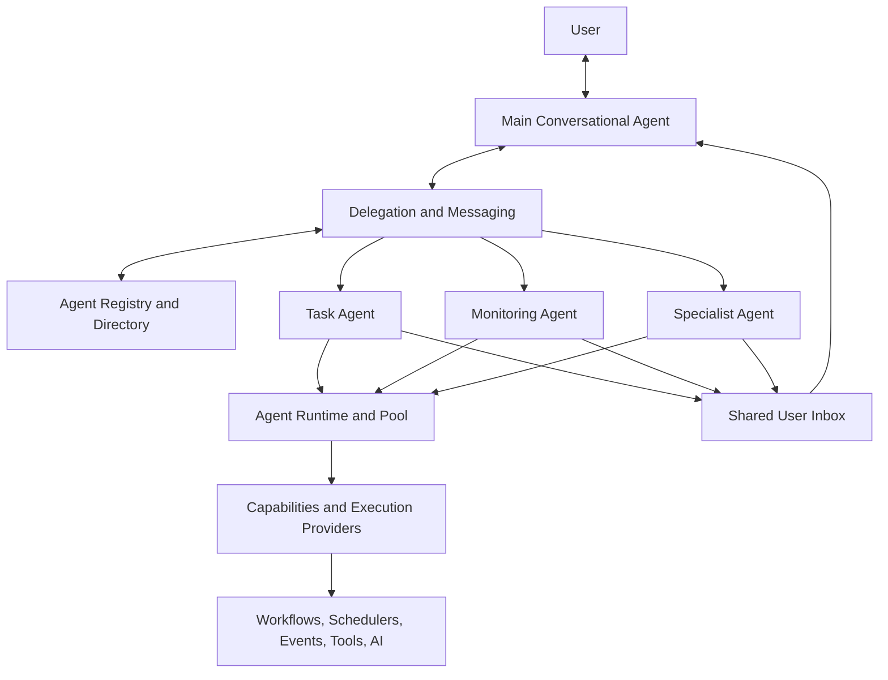

# Agentropy

**Composable, capability-driven multi-agent framework for reliable autonomous work.**

Agentropy models agents as reusable definitions with configurable capability profiles, independent logical identities and lifecycles, and pluggable execution backends. It supports conversational, task-oriented, monitoring, and coordinating agents, with visible delegation and a unified user experience.

> **Project stage:** M1 walking skeleton complete (2026-11-05, [retrospective](docs/review/2026-11-05-m1-retrospective.md)); M2 complete (2026-11-06) for a single-process runtime with pluggable remote providers — A2A 1.0 JSON-RPC and custom brokers, an OpenAI-compatible reasoning adapter, workflow engines, OpenTelemetry, tenant quotas and a [threat model](docs/security/threat-model.md). M3 (PostgreSQL, multi-worker, upgrades, production hardening) is in progress: a PostgreSQL store adapter ([ADR-0028](docs/adr/0028-postgresql-store-adapter.md)) passes the shared store conformance suite, and several workers (in-process or separate processes) can share one store with exactly-once dispatch, fair tenant ordering and cross-worker cancel; instances can be upgraded and rolled back with an audit trail, and checkpoints carry codec versions ([ADR-0029](docs/adr/0029-upgrades-and-version-migration.md)); the audit trail has retention floors, legal holds, receipted disposal and external anchors; a Conductor workflow adapter and a reusable [conformance kit](docs/conformance-kit.md) cover a second workflow engine; a container image and Kubernetes/OpenShift manifests come with a [self-hosting guide](docs/deployment.md), and [SLOs](docs/slo.md) are set from measurements. Only what is listed in [CHANGELOG.md](CHANGELOG.md) under a drained root is implemented and tested.

## Why Agentropy?

An AI assistant can delegate an objective to a specialized agent that works across conversation sessions, uses scheduled or event-driven execution, invokes tools and deterministic workflows, and reports meaningful progress or results. Users interact primarily through one conversational assistant, while optionally seeing agents and their assignments.

Agentropy separates **multi-agent collaboration (the user-facing model)** from **workflow and runtime execution (implementation mechanisms)**. A workflow can power an agent; an agent does not have to run an LLM continuously. Agentropy aims to provide consistent identity, capability, delegation, reliability, and governance contracts, rather than build another general-purpose workflow engine.

## Core model

- **Agent definition:** Versioned specification of identity, role/profile, required/default/optional capabilities, policies and runtime requirements.
- **Agent instance:** Logical, owned, persistent agent identity created from a definition; independent of any single process.
- **Delegated task:** A bounded objective assigned to an agent, with its own status, ownership, audit trail, and reporting.
- **Execution:** An individual attempt or continuation of work. A task may involve multiple executions; a process/worker is not an agent identity.
- **Agent profile:** Reusable capability bundle (e.g. Conversational, Task, Monitoring, Coordinator, Specialist) with required, default, and optional capabilities.
- **Capabilities:** Composable behaviors and guarantees, with explicit contracts, policies and provider dependencies. Durability is a runtime guarantee, while autonomy is a constrained decision policy.
- **Registry:** Discovery of definitions and capabilities; separately tracks logical instances.
- **Pool:** Capacity, scheduling and leases of physical execution resources; always-on agents need not permanently occupy workers.
- **Runtime:** Lifecycle transitions, execution, checkpointing, resumption and recovery through pluggable providers.
- **Inbox:** Durable progress, outcome, approval and notification records; the main assistant communicates with the user according to preferences and importance.

## Conceptual architecture

Definitions, instances, tasks, and executions are separate persisted concepts. Delegations and results cross agent boundaries through explicit, authorized messages. The diagram is logical; components do not each require their own service.

## Initial profiles

| Profile | Required / default (see [Capability v1](docs/contracts/capability-v1.md)) | Optional additions |
|---|---|---|
| Conversational | Conversation, session context; delegation by default | Memory, tools, reasoning |
| Task | Durable execution; notification by default | Scheduling, events, workflow, reasoning, human input |
| Monitoring | Event handling, durable execution; scheduling and notification by default | Delegation, reasoning |
| Coordinator | Delegation, durable execution | Conversation, workflow, reasoning |
| Specialist | Tool use by default | Reasoning, memory, conversation |

Profiles are templates, not a rigid inheritance hierarchy. Required capabilities are enforced; defaults may be overridden. A Task Agent need not be scheduled: scheduling is supported when needed.

## Non-goals (initial scope)

- Replacing Temporal, LangGraph, Quarkus Flow, or another workflow/agent runtime.
- Treating every workflow as an LLM agent, or requiring continuous model inference for always-on behavior.
- Enforcing a single framework, vendor, language, UI, transport, or cloud provider.
- Building a centralized distributed orchestration platform in the first milestone.

## Documentation

- [Vision and scope](docs/vision.md)
- [Requirements](docs/requirements.md)
- [Walking skeleton (M1) scope and acceptance checks](docs/poc-scope.md)
- [Architectural reuse assessment from langgraph-flows](docs/reuse-from-langgraph-flows.md)
- [Task lifecycle and version compatibility](docs/runtime-contract.md)
- [Agent messaging contracts](docs/messaging-contract.md)
- [Human actions and proactive priority](docs/human-actions.md)
- [Architecture](docs/architecture.md)
- [Core Agent Contract v1](docs/contracts/agent-v1.md)
- [Core Capability Contract v1](docs/contracts/capability-v1.md)
- [Pluggable Communication Contract v1](docs/contracts/communication-v1.md)
- [Error Contract v1](docs/contracts/errors-v1.md)
- [Agent Implementation Contract v1](docs/contracts/agent-implementation-v1.md)
- [Tool Contract v1](docs/contracts/tool-v1.md)
- [Skill Contract v1](docs/contracts/skill-v1.md)
- [Security Contract v1 (M1 PEP/PDP/audit)](docs/contracts/security-v1.md)
- [Domain model](docs/domain-model.md)
- [Capabilities and profiles](docs/capabilities.md)
- [Registry, pool and runtime](docs/registry-runtime.md)
- [Delegation, inbox and user experience](docs/collaboration.md)
- [Security, reliability and operability](docs/operations.md)
- [Architecture decision records](docs/adr/README.md)
- [Design review 2026-11-04](docs/review/2026-11-04-design-review.md)
- [Active backlog (todo-skills)](TODO.md) · [acceptance matrix](docs/plans/acceptance-matrix.json) · [readiness signoff](docs/review/2026-11-05-readiness-signoff.md)
- [Change log](CHANGELOG.md)

## Cross-project design reuse

The [langgraph-flows assessment](docs/reuse-from-langgraph-flows.md) captures reusable patterns from an existing Flow-centered platform, adapted here for Agentropy's **agent-centered** abstractions. It contributes requirements and design considerations only: no code or runtime dependency has been imported.

## Working principles

Keep the core contracts small; prefer composition over inheritance and provider adapters over coupling. Treat security boundaries, durability claims and autonomy policies as explicit. Every implementation milestone should include acceptance checks, examples and concise automated tests.

## Status and contributions

Architecture readiness gates are closed ([signoff](docs/review/2026-11-05-readiness-signoff.md)) and the backlog runs on [todo-skills](https://github.com/bassemZohdy/todo-skills): `TODO.md` is the live task tree, `CHANGELOG.md` records verified roots. Implemented functionality is exactly what drained roots in the changelog describe: contract types and schemas, the acceptance resolver, registries, tools, skills, the SQLite store, the task service and runtime, communication routing, wake-ups, the outbox relay and inbox projection, conversation turns with briefing, human actions, the ADR-0024 dispatch gate with mandatory audit intent, a local `createLocalApp` facade for the `AgentService` operations, offline AC/SEC suites for every M1 criterion, and the two runnable journeys: `pnpm example:price-watch` (J1, no model) and `pnpm example:expense-approval` (J2, fake model plus human approval). The single-process M1 walking skeleton is complete; see the [M1 retrospective](docs/review/2026-11-05-m1-retrospective.md) for what it does not cover. The project is [Apache-2.0 licensed](LICENSE) and uses [DCO](CONTRIBUTING.md); live DCO PR verification is still pending (TASK-025). No API stability or production readiness claims are made.

Tests: `pnpm check`
