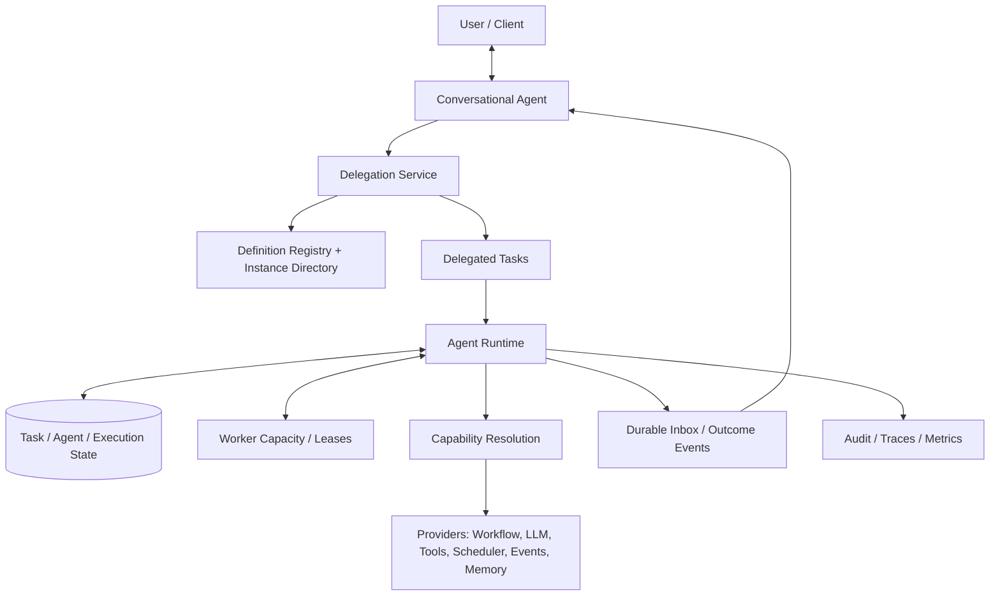

# Architecture overview

## Architectural style

Agentropy has a small logical **agent control model** and pluggable **execution facilities**. A monolithic/in-process deployment is the first implementation target; service separation is optional. Agent-centric collaboration is exposed to users and API consumers, while deterministic workflow execution may operate beneath each agent.

## Responsibilities

| Component | Owns | Does not own |
|---|---|---|
| Agent definition registry | Profile, capabilities, versions, supported requirements | Individual task or worker state |
| Instance directory | Logical identities, owners, effective config, lifecycle metadata | Process allocation |
| Task/delegation service | Authorized assignment, objectives, parent-child linkage and status | Framework-specific checkpoints |
| Runtime | Execution contracts, state transitions and provider selection | User-facing persona or underlying provider internals |
| Pool | Concurrent execution slots, fair scheduling, leases | Persistent logical agent ownership |
| Capability resolver | Required/default/optional composition, dependency validation | Security exceptions or silent downgraded guarantees |
| Providers | Specific workflow, events, scheduling, model, memory, tools | Definition identity and collaboration policy |
| Inbox | Durable reports, approval requests, notifications and acknowledgement | All agent execution state |

## Core relationships

- **Definition 1 -> N Instances** (including on-demand instances).
- **Instance 1 -> N Tasks** (logical responsibility may be long-lived).
- **Task 1 -> N Executions** (attempts/continuations) and **Task 1 -> N child tasks** with bounded fan-out.
- **Execution 0..1 -> lease** while physically running. Durable tasks can be dormant without lease.
- **Capability contract -> provider binding** is validated at registration and runtime.
- **Outcome event -> inbox entry** through a reliable transactional outbox or equivalent; transport is selectable.

## End-to-end delegation

1. User describes goal to conversational agent.
2. Conversation agent evaluates whether to handle directly or delegate with explicit user-facing acknowledgement when relevant.
3. Discovery selects an authorized definition/instance based on capabilities and ownership.
4. Delegation creates a durable task with objective, limits, parent-child trace, principal and consent requirements.
5. Runtime activates the agent, leases capacity when needed and invokes capabilities/providers.
6. A task may wait for a schedule/event/approval without occupying a worker. The runtime persists wake-up intent.
7. Progress and outcomes are written to the task record and emitted to the inbox using a reliable publication pattern.
8. Main assistant reads pending inbox updates at session start or on authorized push, then delivers user-relevant updates; user can inspect or cancel work.

## Critical boundaries

User-facing agency must not depend on adding additional conversational personas. Provider failures must not silently break agent lifecycle guarantees. On resumption, idempotency keys must protect external side effects; recoverability is a property of the complete state/event/provider chain, not an in-memory boolean flag.

## Explicit open design questions

The initial language/runtime, storage backend, event transport, scheduler mechanism, inter-agent protocol and deployment topology remain undecided. Candidate integrations include LangGraph, Temporal and Quarkus Flow as **optional providers**, not framework dependencies. Their supported guarantees require integration tests before any adapter is described as production ready.
