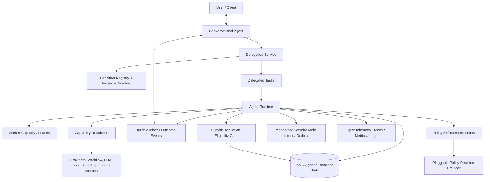

# Architecture overview

## Architectural style

Agentropy has a small logical **agent control model** and pluggable **execution facilities**. A monolithic/in-process deployment is the first implementation target; service separation is optional. Agent-centric collaboration is exposed to users and API consumers, while deterministic workflow execution may operate beneath each agent.

## Responsibilities

| Component | Owns | Does not own |
|---|---|---|
| Agent definition registry | Profile, capabilities, versions, supported requirements | Individual task or worker state |
| Instance directory | Logical identities, owners, effective config, lifecycle metadata | Process allocation |
| Task/delegation service | Authorized assignment, objectives, parent-child linkage and status | Framework-specific checkpoints |
| Runtime | Execution contracts, state transitions and provider selection | User-facing persona or underlying provider internals |
| Pool | Concurrent execution slots, fair scheduling, leases | Persistent logical agent ownership |
| Capability resolver | Required/default/optional composition, dependency validation | Security exceptions or silent downgraded guarantees |
| Providers | Specific workflow, events, scheduling, model, memory, tools | Definition identity and collaboration policy |
| Inbox | Durable reports, approval requests, notifications and acknowledgement | All agent execution state |
| Governance PEPs/PDP | Mandatory policy enforcement and pluggable decision evaluation across protected operations | Task lifecycle state ownership or identity inferred from messages |
| Credential provider | Just-in-time scoped credential resolution and rotation (later adapters) | Secrets in snapshots/checkpoints/messages |
| Audit service | Independent durable mandatory security evidence, verification and retention policies | Sampled tracing or task orchestration |
| Observability provider | Correlated OpenTelemetry spans, metrics and redacted diagnostic logs | Security audit authority or permissions |

## Call layering

Agent handlers act only through `CapabilityAccess`; delegation goes handler → `delegation` capability → TaskService → (local runtime | CommunicationRouter → A2A/custom provider). Inbound remote calls enter through an adapter that verifies the caller and calls the same TaskService. Diagram: [Agent v1 — call layering](contracts/agent-v1.md#call-layering).

## Pluggable agent communication

Agents invoke a common [AgentCommunication contract](contracts/communication-v1.md) through a router and interchangeable providers: **internal/direct**, **A2A**, and **custom/broker/RPC**. A2A is the preferred interoperable protocol for independently deployed agents; direct invocation is allowed for co-located agents. Routing is policy- and capability-aware and is pinned for each delegated task. The target's authoritative runtime owns its lifecycle; a remote A2A task is represented locally as a tracked projection, not an independently controlled task. See [ADR-0015](adr/0015-pluggable-agent-communication.md).

## Core relationships

- **Definition 1 -> N Instances** (including on-demand instances).
- **Instance 1 -> N Tasks** (logical responsibility may be long-lived).
- **Task 1 -> N Executions** (attempts/continuations) and **Task 1 -> N child tasks** with bounded fan-out.
- **Execution 0..1 -> lease** while physically running. Durable tasks can be dormant without lease.
- **Capability contract -> provider binding** is validated at registration and runtime.
- **Outcome event -> inbox entry** through a reliable transactional outbox or equivalent; transport is selectable.

## End-to-end delegation

1. User describes goal to conversational agent.
2. Conversation agent evaluates whether to handle directly or delegate with explicit user-facing acknowledgement when relevant.
3. Discovery selects an authorized definition/instance based on capabilities and ownership.
4. Delegation creates a durable task with objective, limits, parent-child trace, principal and consent requirements.
5. Runtime activates the agent, leases capacity when needed and invokes capabilities/providers.
6. A task may wait for a schedule/event/approval without occupying a worker. The runtime persists wake-up intent.
7. Progress and outcomes are written to the task record and emitted to the inbox using a reliable publication pattern.
8. Main assistant reads pending inbox updates at session start or on authorized push, then delivers user-relevant updates; user can inspect or cancel work.

## Transport and lifecycle overlays

The baseline collaboration contract is **asynchronous-first**: a successful delegation returns a task reference, and status/results arrive independently. The AgentRuntime owns the authoritative task lifecycle; no conversational tool or message transport may mutate task state directly. Use [messaging contracts](messaging-contract.md) for versioned commands/queries/events, [runtime contract](runtime-contract.md) for state transitions and durable upgrade rules, and [human actions](human-actions.md) for validated approvals and shared priority.

The shared inbox is a **projection** of relevant task events: a durable event/outbox boundary and reconciliation with task state repair missed or duplicated publication. Persistent agent identity and task obligations survive conversation disconnects. Runtime-specific workflow histories remain internal to providers; LangGraph/Temporal integration is optional. These patterns are adapted from [langgraph-flows](reuse-from-langgraph-flows.md), not copied as a Flow-first runtime.

## Security, audit and observability overlays

Authorization is evaluated through mandatory framework PEP boundaries, with a pluggable PDP and verified actor/tenant/delegated authority. An unavailable PDP denies protected effects without automatically deleting an accepted durable task. [ADR-0024](adr/0024-pre-dispatch-authorization-gate.md) keeps `created` / `assigned` task states and defers activation with a durable non-lifecycle eligibility gate until current policy can be checked; the gate is not a new task state. The [runtime contract](runtime-contract.md) remains authoritative for actual state transitions.

Credentials are resolved through a pluggable CredentialProvider, with opaque tenant-scoped references instead of tokens in persistent agent/task state. Mandatory security audit intent is committed in the protected change transaction or via a transactional outbox; remote sink acknowledgement may be asynchronous. Audit access, retention and integrity follow [ADR-0022](adr/0022-security-audit-governance.md). OpenTelemetry remains a separate, optional exporter path with W3C context propagation where carrier-compatible and **never provides identity or authorization**; see [ADR-0020](adr/0020-opentelemetry-observability.md).

The five [logical communication families](contracts/communication-v1.md#logical-communication-families-and-v1-spi-coverage-adr-0019) describe protocol-neutral behavior and are **not five guaranteed v1 SPI endpoints**. General bidirectional streaming, generic inquiry and discovery extensions must be negotiated and may remain unsupported in M1; remote A2A interoperability is M2.

## Critical boundaries

User-facing agency must not depend on adding additional conversational personas. Provider failures must not silently break agent lifecycle guarantees. On resumption, idempotency keys must protect external side effects; recoverability is a property of the complete state/event/provider chain, not an in-memory boolean flag.

## Explicit open design questions

M1 implementation baseline decisions are accepted in [ADR-0016](adr/0016-implementation-language.md) (TypeScript/Node.js/ESM/pnpm), [ADR-0017](adr/0017-first-persistence-and-activation.md) (SQLite/polling/in-process event bus) and [ADR-0024](adr/0024-pre-dispatch-authorization-gate.md) (policy eligibility gate). [ADR-0018](adr/0018-execution-per-activation.md) remains Proposed at its own status, despite the runtime contract using its one-execution-per-activation model. The A2A SDK/version, production storage and deployment topology remain undecided. Candidate integrations include LangGraph, Temporal and Quarkus Flow as **optional providers**, not framework dependencies. Their supported guarantees require integration tests before any adapter is described as production ready.

## Protocol-agnostic Tool Integration (accepted direction, 2026-11-05)

Agentropy defines two parallel, domain-specific integration boundaries. Agent-to-agent communication uses the existing [Communication v1](contracts/communication-v1.md) provider abstraction (internal, A2A, custom). Tool integration separately exposes a canonical ToolRegistry / ToolExecutor and pluggable ToolProvider SPI (MCP, UTCP, REST/OpenAPI, custom). Both follow common registry, security-policy, observability and conformance principles without conflating agent messages with tool invocation. A Capability describes what an agent can do; a Tool is a callable operation.

Logical tool identity is separate from its provider binding. Authorization, provenance-verified activation, delegated scopes, tenant isolation, credential resolution and mandatory audit are framework-controlled regardless of adapter (ADR-0021). Providers negotiate supported guarantees; retries or fallback for uncertain external effects require idempotency and safe reconciliation. Concrete interfaces, SDKs and tests remain pending. See [ADR-0026](adr/0026-protocol-agnostic-tool-integration.md).
