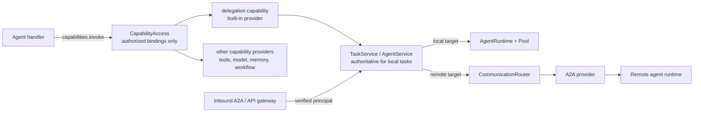

# Agentropy Agent Contract v1.0 — Design baseline (revision 2)

**Status:** Architecture contract for initial implementation; not yet implemented or API-stable.
**Scope:** Core logical Agent, AgentDefinition, AgentInstance, DelegatedTask and Execution. Transport/runtime are independent.
**Lifecycle states and edges:** [runtime contract](../runtime-contract.md) is authoritative. **Errors:** [Errors v1](errors-v1.md).

## Revision history

| Rev | Date | Change |
|---|---|---|
| 1 | 2026-11-04 | Initial baseline |
| 3 | 2026-11-04 | Re-review: conversation turn model; handler registry; retry policy; `DelegateInput`; child-task/human-action/event wake semantics with inline payload; `TaskHandle.status` uses task states; instance and human-action operations on `AgentService`; record types; effect-journal commit timing |
| 2 | 2026-11-04 | Design review: instance states aligned with lifecycle; one execution per activation; `WakeupRequest` extended (timer, child tasks, any-of, timeout); idempotent step keys for side effects; `AgentService` gains `getResult`, `provideHumanInput`, idempotency lookup; explicit call layering ([review](../review/2026-11-04-design-review.md)) |

## Decisions

1. **Composition over inheritance.** Conversational, Task, Monitoring, Coordinator and Specialist are **profile IDs**, not subclasses.
2. **Four separate identities.** Definition = versioned blueprint; Instance = logical owner-scoped identity; Task = assigned objective; Execution = one activation of the handler for a task. No instance is a worker process.
3. **Agent implementation is a bounded handler.** It receives a context and an invocation, and returns a typed disposition. It never writes lifecycle state or owns orchestration.
4. **Delegation is async-first.** Acceptance returns a `TaskHandle`; completion arrives by status/events/inbox. Handler completion is not user notification.
5. **Always-on = durable responsibility + reactivation.** A long-lived responsibility is a non-terminal task that cycles `waiting ⇄ running`; each wake-up is a new Execution ([ADR-0018](../adr/0018-execution-per-activation.md)).
6. **Security is mandatory platform context.** Tenant, principal and delegated scope come from trusted services, never from model output.

## Call layering

Handlers never call the TaskService, router or providers directly. Every outbound action goes through the injected `CapabilityAccess`:



`AgentService` is the public, principal-taking API used by applications, the conversational surface and inbound adapters. `AgentCommunication` ([Communication v1](communication-v1.md)) is an **outbound SPI used only by the TaskService** for remote targets.

## TypeScript contract (normative conceptual shape)

```ts
export type AgentId = string;
export type AgentInstanceId = string;
export type TaskId = string;
export type ExecutionId = string;
export type Version = string;

export type AgentProfileId =
  | "conversational" | "task" | "monitoring"
  | "coordinator" | "specialist" | (string & {});

export interface VersionedRef { id: string; version: Version; }

export interface AgentDefinition {
  id: AgentId;
  version: Version;                 // immutable once registered
  displayName: string;
  profile: VersionedRef;
  capabilities: CapabilitySelection[];   // additions/removals relative to profile
  inputSchema: JsonSchema;
  outputSchema?: JsonSchema;
  runtimeRequirements: RuntimeRequirements;
  policyRef: VersionedRef;
  retryPolicy?: { maxAttempts: number; backoff: { initialMs: number; maxMs: number; multiplier: number } };
}

export interface AgentInstance {
  id: AgentInstanceId;
  definition: VersionedRef;         // default for FUTURE tasks
  tenantId: string;
  ownerId: string;                  // principal that owns the logical agent
  state: "available" | "suspended" | "retired";
  revision: number;
}

export interface AgentInvocation<I = unknown> {
  taskId: TaskId;
  executionId: ExecutionId;
  activation: number;               // 1 for first run, +1 per wake-up (not per retry)
  attempt: number;                  // 1.., +1 per retry within this activation
  input: I;                         // original task input
  trigger: "delegation" | "resume" | "retry";
  checkpoint?: unknown;             // last committed checkpoint, absent on first activation
  wakeReason?: WakeReason;          // which condition fired, on resume
}

export interface AgentContext {
  readonly tenantId: string;
  readonly agentInstanceId: AgentInstanceId;
  readonly taskId: TaskId;
  readonly executionId: ExecutionId;
  readonly principal: TrustedPrincipal;   // the agent instance acting under delegatedAuthority
  readonly correlationId: string;
  readonly causationId?: string;
  readonly deadline?: string;
  readonly signal: AbortSignal;           // fired on cancel or lease loss
  readonly capabilities: CapabilityAccess;
  readonly progress: ProgressReporter;
}

export type AgentDisposition<O> =
  | { kind: "completed"; output: O }
  | { kind: "waiting"; wakeup: WakeupRequest; checkpoint: unknown }
  | { kind: "failed"; code: string; retryable: boolean; message: string };

export interface Agent<I = unknown, O = unknown> {
  readonly definition: VersionedRef;
  handle(invocation: AgentInvocation<I>, context: AgentContext):
    Promise<AgentDisposition<O>>;
}

// --- Wake-ups --------------------------------------------------------------

export type WakeupCondition =
  | { kind: "timer"; at: string }                         // one-shot ISO instant
  | { kind: "schedule"; cron: string; timezone: string }  // next occurrence only; re-register each activation
  | { kind: "event"; subscription: string; filter?: unknown }
  | { kind: "human-action"; requestId: string }
  | { kind: "child-tasks"; taskIds: TaskId[]; mode: "all" | "any" };  // over TERMINAL states (completed, failed, cancelled)

export interface WakeupRequest {
  anyOf: WakeupCondition[];          // first condition to fire wins; others are revoked
  timeoutAt?: string;
  onTimeout?: "resume" | "fail";     // default "resume" with wakeReason.kind = "timeout"
}

export type WakeReason =
  | { kind: "timer" | "schedule"; firedAt: string }
  | { kind: "event"; subscription: string; eventId: string; payload: unknown }   // oldest pending mailbox event
  | { kind: "human-action"; requestId: string; outcome: "resolved" | "expired" | "revoked"; input?: unknown }
  | { kind: "child-tasks"; children: { taskId: TaskId; status: "completed" | "failed" | "cancelled";
        output?: unknown; outcome?: { code: string; message: string } }[] }
  | { kind: "timeout" };

// --- Public service --------------------------------------------------------

export interface TaskHandle {
  taskId: TaskId;
  agentInstanceId: AgentInstanceId;
  status: "created" | "assigned";   // task state at acceptance (rev 2 used non-state values)
  definition: VersionedRef;
  durability: "none" | "durable-acceptance" | "durable-execution";
}

export interface AgentService {
  // Tasks
  delegate<I>(request: DelegationRequest<I>, caller: TrustedPrincipal): Promise<TaskHandle>;
  getTask(taskId: TaskId, caller: TrustedPrincipal): Promise<TaskSnapshot>;
  getTaskByIdempotencyKey(key: string, caller: TrustedPrincipal): Promise<TaskSnapshot>;
  getResult<O>(taskId: TaskId, caller: TrustedPrincipal): Promise<O>;   // NotReady / TaskFailed / TaskCancelled
  cancel(taskId: TaskId, caller: TrustedPrincipal, reason?: string): Promise<TaskSnapshot>;
  subscribe(taskId: TaskId, caller: TrustedPrincipal, from?: { revision: number; sequence: number }): AsyncIterable<TaskEvent>;
  // Conversation (see "Conversation turn model")
  submitTurn(turn: ConversationTurn, caller: TrustedPrincipal): Promise<TaskHandle>;
  // Instances
  createInstance(req: { definition: VersionedRef; ownerId: string; idempotencyKey: string }, caller: TrustedPrincipal): Promise<AgentInstance>;
  suspendInstance(instanceId: AgentInstanceId, caller: TrustedPrincipal): Promise<AgentInstance>;
  resumeInstance(instanceId: AgentInstanceId, caller: TrustedPrincipal): Promise<AgentInstance>;
  retireInstance(instanceId: AgentInstanceId, caller: TrustedPrincipal, opts?: { force?: boolean }): Promise<AgentInstance>;
  // Human actions (types in human-actions.md)
  claimHumanAction(requestId: string, caller: TrustedPrincipal): Promise<HumanActionRequest>;
  releaseHumanAction(requestId: string, caller: TrustedPrincipal): Promise<HumanActionRequest>;
  provideHumanInput(decision: HumanDecision, caller: TrustedPrincipal): Promise<void>;
  // Inbox (projection; types in human-actions.md)
  listInbox(query: { cursor?: string; limit?: number }, caller: TrustedPrincipal): Promise<{ entries: InboxEntry[]; cursor: string }>;
  markInbox(entryId: string, marker: "presented" | "read" | "acknowledged", caller: TrustedPrincipal, presentedRevision?: number): Promise<void>;
}

export interface ConversationTurn {
  instanceId: AgentInstanceId;      // the user's conversational agent instance
  sessionId: string;
  text: string;
  idempotencyKey: string;
  correlationId?: string;           // generated if absent
}

/** What a handler passes to delegation.delegate; the runtime fills the rest. */
export interface DelegateInput<I = unknown> {
  target: DelegationRequest<I>["target"];
  input: I;
  deadline?: string;
  budget?: DelegationRequest<I>["budget"];
}
// Runtime fills: idempotencyKey = derived from stepKey; correlationId = context.correlationId;
// parentTaskId = context.taskId; caller = the acting instance under its delegated authority.

export interface TrustedPrincipal {
  id: string;
  type: "user" | "agent" | "service";
  tenantId: string;
  delegatedAuthorityRef?: string;    // grant chain; narrowed, never widened, on each delegation hop
}

export interface DelegationRequest<I> {
  target: { definition?: VersionedRef; instanceId?: AgentInstanceId };
  input: I;
  idempotencyKey: string;
  correlationId: string;
  parentTaskId?: TaskId;
  deadline?: string;
  budget?: { maxCostUnits?: number; maxActivations?: number };
}

export interface TaskSnapshot {
  taskId: TaskId;
  status: "created" | "assigned" | "running" | "waiting"
    | "completed" | "failed" | "cancelled";
  revision: number;
  agentInstanceId?: AgentInstanceId;
  parentTaskId?: TaskId;
  retryOf?: TaskId;
  cancelRequestedAt?: string;
  waitingOn?: WakeupRequest;
  outcome?: { code: string; message: string };   // for failed/cancelled
  authority: "local" | "remote";                  // remote = projection of an A2A task
}

export interface ProgressReporter {
  report(progress: { message: string; percent?: number; stepKey?: string }): Promise<void>;
}

// --- Records (persisted by the platform; read via getTask / internal APIs) ---

export interface ExecutionRecord {
  executionId: ExecutionId;
  taskId: TaskId;
  activation: number;
  attempt: number;
  trigger: AgentInvocation["trigger"];
  state: "queued" | "leased" | "running" | "succeeded" | "yielded" | "failed" | "aborted" | "lost";
  leaseEpoch?: number;
  startedAt?: string;
  endedAt?: string;
}

export interface WakeupRegistration {
  id: string;
  taskId: TaskId;
  conditions: WakeupCondition[];
  timeoutAt?: string;
  onTimeout: "resume" | "fail";
  status: "armed" | "fired" | "revoked";
  revision: number;
}

/** Binds handler code to definition versions. Definitions live in the registry; code lives here. */
export interface HandlerRegistry {
  register(definition: VersionedRef, handler: Agent): void;
  unregister(definition: VersionedRef): void;      // in-flight tasks pinned to it then fail IncompatibleVersion
  get(definition: VersionedRef): Agent | undefined;
}

// Defined elsewhere:
//   CapabilitySelection, RuntimeRequirements, CapabilityAccess -> capability-v1.md
//   HumanDecision, HumanActionRequest, InboxEntry -> human-actions.md; TaskEvent -> messaging-contract.md
//   JsonSchema = JSON Schema 2020-12 document
```

Import paths are documentation references, not compiled modules.

## Idempotent side effects

A crashed or lost execution is re-run (T6), so handlers must be **replay-safe**:

- Every capability operation is classified `read`, `internal` or `external` ([Capability v1](capability-v1.md#contract-types-normative-conceptual-shape)). `external` and `delegate` operations **require** a `stepKey` in `capabilities.invoke(..., { stepKey })`.
- The runtime derives the effective idempotency key as `hash(tenantId, taskId, capabilityId, operation, stepKey)`. The same step in a later activation or attempt therefore reuses the same key.
- **Effect journal timing:** the journal entry is committed **at invocation time, independent of the disposition transaction** (which may never commit if the worker crashes). For platform-internal effects (inbox notification, child-task creation, human-action creation) the effect and its journal entry are written in **one** transaction, so they are exactly-once. For external effects the runtime checks the journal first, passes the key to the provider, and records the result when the call returns; a crash between provider success and journal write is covered only by the provider honoring the key — a provider that cannot must declare so and is treated as at-least-once.
- `stepKey` must be deterministic from task input + checkpoint (e.g. `"notify:threshold-crossed:2026-11-04"`), never a random value or timestamp of the current run.
- Child delegations use the same mechanism, so a re-run coordinator does not spawn duplicate children. For agent callers the deduplication key below is the derived key.

## Lifecycle authority and invariants

- Transitions are applied only by the TaskService/AgentRuntime using the [transition tables](../runtime-contract.md).
- `waiting` commits checkpoint + wake-up registration before releasing the lease.
- `completed`, `failed`, `cancelled` are terminal. Retrying a terminal task creates a **new task linked by `retryOf`**; execution recovery creates a new Execution under the same non-terminal task.
- Delegation is deduplicated on `(tenantId, caller.id, idempotencyKey)`; reuse with a different request fingerprint fails `IdempotencyConflict`.
- Cancellation is a request; it never undoes committed external effects.
- Version snapshot taken at acceptance; instances adopt newer definitions for future tasks only.
- Authorization is checked at acceptance and again at sensitive side effects, human decisions and protected reads.

## Conversation turn model

Each user message is one **turn task** delegated to the user's conversational instance by `AgentService.submitTurn` (durability `durable-acceptance`). The turn handler:

1. calls `conversation.briefing` first — returns a bounded, authorized inbox snapshot of entries not yet presented at their current revision, and marks them `presented`;
2. decides, optionally via `reasoning`, whether to answer directly or call `delegation.delegate` (it does **not** wait for the child; the child reports through the inbox);
3. completes with `{ reply: string }`, which the client reads via `getResult`/`subscribe`.

Session continuity lives in `session-context` keyed by `sessionId`, not in a long-running task. A conversational agent can therefore be fully rule-based (no `reasoning` binding) or model-backed with the same contract.

## Agent vs capability boundary

A handler expresses business logic and acts only through the injected `CapabilityAccess`. It must not construct providers, read global registries, acquire leases, generate its own idempotency keys for effects, or assume a specific LLM/workflow engine. Workflow-backed and model-backed agents satisfy the same contract.

## Validation gate


Distinct identity tests; profile resolution; acceptance + idempotency + unknown acceptance; unauthorized delegation; disposition mapping; wait → restart → resume with checkpoint; child-task wait (`all`/`any`); timeout wake-up; stale lease fencing; cancellation with non-cooperative handler; step-key replay without duplicate effect; version pinning; multi-instance isolation; deterministic workflow-only agent; conversational turn that delegates and a later turn whose briefing reports the result. Each maps to an acceptance check in [POC scope](../poc-scope.md) or a later milestone.

## Agent Skills selection (2026-11-05 design addendum; pending contract revision)

AgentDefinition will select standard [Agent Skills](https://agentskills.io/specification) **independently** from `capabilities`, with an optional versioned `skills?: SkillSelection[]` field in the next explicit schema revision. Conceptual form:

```ts
interface SkillSelection {
  id: string;            // stable registry ID; not a filesystem path supplied by an agent
  versionRange: string;  // resolved to an immutable version for task acceptance
  required?: boolean;    // required Skill missing => typed resolution failure
}
// AgentDefinition addition: skills?: SkillSelection[]
```

Each Skill preserves the open standard's `SKILL.md` and optional resources. SkillRegistry performs trusted discovery/version resolution; SkillLoader performs metadata-first and on-demand instruction/resource loading. These platform components do not add another agent execution lifecycle. Agent handler still obtains authorized behavior through `CapabilityAccess`; tool/script invocation passes policy gates, never gains authorization from Skill text. Resolved Skill versions must be pinned for execution consistency; exact selection constraints and schema updates require contract review. See [ADR-0026](../adr/0026-protocol-agnostic-tool-integration.md).
