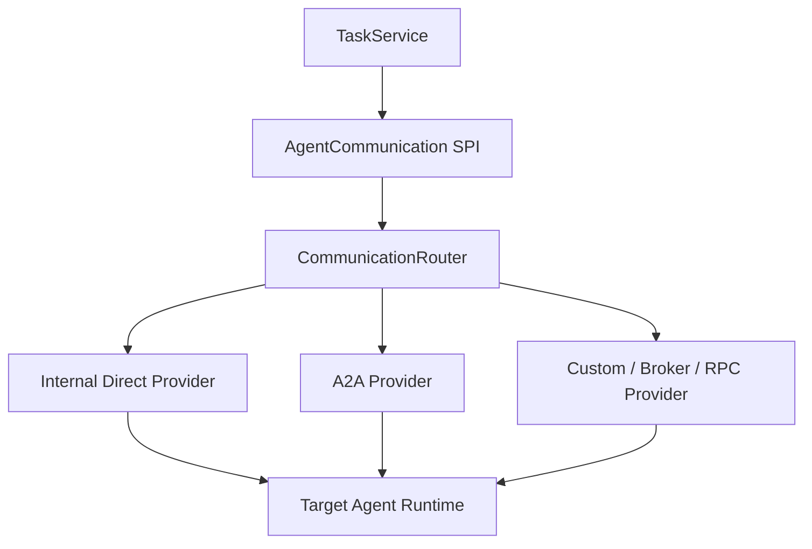

# Agentropy Communication Contract v1 — Architecture baseline

**Status:** Agreed architecture direction; interface design proposed for implementation validation. **No implementation exists yet.**  
**Decision:** [ADR-0015](../adr/0015-pluggable-agent-communication.md). **Errors:** [Errors v1](errors-v1.md).

## Revision history

| Rev | Date | Change |
|---|---|---|
| 1 | 2026-11-04 | Initial baseline |
| 2 | 2026-11-04 | Design review: AgentCommunication is an **outbound SPI of the TaskService**, not a handler API; every operation carries a `CallContext` (caller principal); duplicate `target` parameter removed from `delegate`; inbound path defined; remote task projection fields named |

## Position in the call stack

Handlers delegate through the `delegation` capability; the TaskService decides whether the target is local or remote. Only for **remote** targets (and for local targets when policy forces A2A) does it call the router. Inbound A2A requests terminate at an A2A server adapter that verifies the caller and calls `AgentService.delegate`. See the layering diagram in [Agent v1](agent-v1.md#call-layering).

For local, co-located targets the TaskService calls the runtime directly; the "internal/direct provider" exists so that the **same router conformance suite** can run without a network, and so a deployment can force all traffic through the router for uniform policy.

## Core principle

Agent handlers never see transports: they delegate through the `delegation` capability, and the TaskService uses the **AgentCommunication SPI** for remote targets. The CommunicationRouter selects a compatible, authorized provider. A2A is preferred for independently deployed agents, while local in-process communication and third-party/custom providers are equally valid implementations of the abstraction. Transport and protocol details never leak into Agent handlers.



## Interfaces (proposed TypeScript)

```ts
export interface AgentRef {
  definitionId: string;
  instanceId?: string;
  version?: string;
  tenantId: string;
  endpoint?: string;            // resolved by the registry for remote agents; never taken from message content
}

export interface CallContext {
  caller: TrustedPrincipal;     // verified by the TaskService before the router is called
  correlationId: string;
  causationId?: string;
  deadline?: string;
  signal?: AbortSignal;
}

export interface RouteBinding {        // persisted on the local task at acceptance; never re-selected
  providerId: string;
  protocol: string;
  protocolVersion: string;
  target: AgentRef;
}

export interface RemoteTaskRef {
  localTaskId: string;          // Agentropy projection record
  route: RouteBinding;
  remoteTaskId: string;
}

export type CommunicationOperation =
  | "delegate" | "send" | "getTask" | "cancel" | "subscribe";

export interface CommunicationFeatures {
  operations: readonly CommunicationOperation[];
  streaming: boolean;
  pushNotifications: boolean;
  durability: "none" | "provider-dependent" | "durable-acceptance";
  protocol: string;
  protocolVersion: string;
}

/** Outbound SPI implemented by each provider. */
export interface AgentCommunicationProvider {
  readonly id: string;
  readonly features: CommunicationFeatures;
  supports(target: AgentRef, operation: CommunicationOperation): boolean;
  delegate<I>(route: RouteBinding, request: DelegationRequest<I>, ctx: CallContext): Promise<RemoteTaskRef>;
  send(route: RouteBinding, message: AgentMessage, ctx: CallContext): Promise<MessageReceipt>;
  getTask(ref: RemoteTaskRef, ctx: CallContext): Promise<RemoteTaskState>;
  cancel(ref: RemoteTaskRef, ctx: CallContext): Promise<RemoteTaskState>;
  subscribe(ref: RemoteTaskRef, ctx: CallContext): AsyncIterable<AgentEvent>;
}

/** Used only by the TaskService. Selects and pins a route, then delegates to the provider. */
export interface CommunicationRouter {
  register(provider: AgentCommunicationProvider): void;
  selectRoute(target: AgentRef, operation: CommunicationOperation, ctx: CallContext): Promise<RouteBinding>;
  provider(route: RouteBinding): AgentCommunicationProvider;   // NoCompatibleRoute if unregistered
}

export interface RemoteTaskState {
  remoteState: string;          // provider's own state value, stored verbatim
  normalized: TaskSnapshot["status"] | "unknown";
  observedAt: string;
}

// References to Agentropy's existing contracts; no parallel task schema:
//   DelegationRequest, TaskSnapshot, TrustedPrincipal -> agent-v1.md
//   AgentMessage -> messaging-contract.md
export interface MessageReceipt { messageId: string; accepted: boolean; }
export interface AgentEvent { eventId: string; taskId: string; type: string; revision?: number; payload: unknown; }
```

Callers never see `RemoteTaskRef`: the public `TaskHandle`/`TaskSnapshot` always carry the **local** task ID, with `authority: "remote"` marking a projection. The TaskService keeps the `RouteBinding` and `RemoteTaskRef` on the task record.

## Provider routing rules

1. Resolve target definition/instance and registered endpoints using the Agent Registry.
2. Authenticate caller and enforce target/operation/tenant/delegated-scope authorization **before** route selection.
3. Filter providers by protocol version, supported operation, target compatibility, policy and required guarantees.
4. Prefer **A2A for independently addressable agents**, **direct for co-located agents** unless policy explicitly requires A2A; allow configured custom adapters.
5. Persist route ownership/remote task mapping for later status/cancel/subscription calls; do not reselect a different provider mid-task.
6. Fail with typed `NoCompatibleRoute`, `PermissionDenied`, `UnsupportedOperation`, `RemoteUnavailable` or `UnknownAcceptance` errors ([Errors v1](errors-v1.md)). No silent security/durability downgrade.

## Delivery and state semantics

- **Delegation acceptance** is separate from completion. A timeout after submission can leave acceptance unknown; reconcile by idempotency key rather than blindly retrying.
- **Local task authority:** Agentropy Task Service. **Remote task authority:** Remote agent/A2A server. Local tracking is a projection of remote state.
- **Task state mapping:** Keep remote state and local normalized status; do not assume A2A and Agentropy state enums are identical. Map terminal states explicitly, and represent unmapped states as unsupported/unknown rather than inventing transitions.
- **Streaming:** Optional. If unsupported, consumers can use polling where allowed; an API requesting streaming specifically gets an explicit unsupported response.
- **Security:** A2A endpoint authentication and end-user delegated authority are distinct. A provider cannot mint or infer user grants from message content.
- **Durability:** Direct provider may support durable acceptance only when the target service persists before acknowledging. A2A protocol support by itself does not imply persisted tasks or exactly-once effects.

## Conformance tests

- Same logical delegate/query/cancel behavior through internal and A2A providers.
- Registry discovery, routing precedence, custom provider registration and authorization.
- Provider operation support/unsupported errors and version negotiation.
- Duplicate request idempotency, unknown acceptance and remote task mapping.
- Streaming interruption, reconnect, out-of-order events and cancellation failure.
- Cross-tenant denial, forged identity, expired delegated grant, untrusted endpoint metadata.
- Durable acceptance only when persistence is proven.

## Open implementation choices

A2A SDK selection, protocol version, actual endpoint hosting, message serialization, routing persistence, broker implementation and runtime language are implementation ADR topics. The architecture decision does **not** claim those are already selected.
