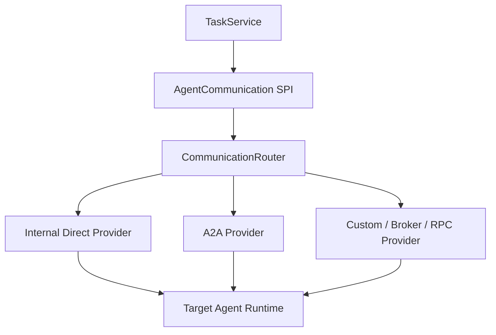

# Agentropy Communication Contract v1 — revision 9

**Status:** Accepted for M1 implementation of the router and direct provider (2026-11-05). A2A and custom providers are M2 (C-03/C-04). Behavior is claimed only where executable tests exist.  
**Decision:** [ADR-0015](../adr/0015-pluggable-agent-communication.md). **Errors:** [Errors v1](errors-v1.md).

## Revision history

| Rev | Date       | Change                                                                                                                                                                                                                                                                                                                                        |
| --- | ---------- | --------------------------------------------------------------------------------------------------------------------------------------------------------------------------------------------------------------------------------------------------------------------------------------------------------------------------------------------- |
| 1   | 2026-11-04 | Initial baseline                                                                                                                                                                                                                                                                                                                              |
| 2   | 2026-11-04 | Design review: AgentCommunication is an **outbound SPI of the TaskService**, not a handler API; every operation carries a `CallContext` (caller principal); duplicate `target` parameter removed from `delegate`; inbound path defined; remote task projection fields named                                                                   |
| 3   | 2026-11-04 | Map ADR-0019 five logical families to existing v1 SPI and document extensions, declared guarantees and transport-neutral tracing                                                                                                                                                                                                              |
| 4   | 2026-11-05 | Readiness closure: `CommunicationFeatures.durability` uses the canonical durability levels (`provider-dependent` counts as `none` for guarantee checks); `extensions` declaration formalized; `RouteRequirements` passed to `selectRoute`; `AgentRef` ↔ `VersionedRef` mapping stated; `AgentEvent` documented as a projection of `TaskEvent` |
| 5   | 2026-11-05 | FEAT-027.8 (C-03, C-04): A2A provider pinned to A2A protocol 1.0 (JSON-RPC binding) — outbound `A2ACommunicationProvider` and inbound `createA2AServer` — and the custom broker/RPC provider sample; both pass the shared conformance suite (see "M2 providers")                                                                              |
| 6   | 2026-11-06 | FEAT-027.9: `RemoteTaskState.output` carries a completed remote result; remote targets in `delegation.delegate` are wired through the router with local projection tasks                                                                                                                                                                      |
| 7   | 2026-11-06 | FEAT-028.9 (M3-09, R-18): federation and discovery through A2A agent cards — `agentCardForDefinition`, `AgentDirectoryFederation` (configured peers only, strict card validation, tenant and policy scoping, delegation target in each result)                                                                                                |
| 8   | 2026-11-11 | FEAT-044.1: `ListTaskPushNotificationConfigs` is paged — `pageSize` 1–100 (default 50), an opaque `pageToken` and `nextPageToken`; configs are ordered by ID |
| 9   | 2026-11-11 | FEAT-044.2: A2A message history — opt-in `history` store option, `historyLength` on `GetTask`, `ListTasks` and `SendMessage` configuration, recorded per sending principal, bounded and compacted with the task |

## Position in the call stack

Handlers delegate through the `delegation` capability; the TaskService decides whether the target is local or remote. Only for **remote** targets (and for local targets when policy forces A2A) does it call the router. Inbound A2A requests terminate at an A2A server adapter that verifies the caller and calls `AgentService.delegate`. See the layering diagram in [Agent v1](agent-v1.md#call-layering).

For local, co-located targets the TaskService calls the runtime directly; the "internal/direct provider" exists so that the **same router conformance suite** can run without a network, and so a deployment can force all traffic through the router for uniform policy.

## Core principle

Agent handlers never see transports: they delegate through the `delegation` capability, and the TaskService uses the **AgentCommunication SPI** for remote targets. The CommunicationRouter selects a compatible, authorized provider. A2A is preferred for independently deployed agents, while local in-process communication and third-party/custom providers are equally valid implementations of the abstraction. Transport and protocol details never leak into Agent handlers.



## Interfaces (proposed TypeScript)

```ts
export interface AgentRef {
  definitionId: string;
  instanceId?: string;
  version?: string;
  tenantId: string;
  endpoint?: string; // resolved by the registry for remote agents; never taken from message content
}

export interface CallContext {
  caller: TrustedPrincipal; // verified by the TaskService before the router is called
  correlationId: string;
  causationId?: string;
  deadline?: string;
  signal?: AbortSignal;
}

export interface RouteBinding {
  // persisted on the local task at acceptance; never re-selected
  providerId: string;
  protocol: string;
  protocolVersion: string;
  target: AgentRef;
}

export interface RemoteTaskRef {
  localTaskId: string; // Agentropy projection record
  route: RouteBinding;
  remoteTaskId: string;
}

export type CommunicationOperation =
  'delegate' | 'send' | 'getTask' | 'cancel' | 'subscribe';

export interface CommunicationFeatures {
  operations: readonly CommunicationOperation[];
  streaming: boolean;
  pushNotifications: boolean;
  /** Canonical levels (runtime contract); "provider-dependent" satisfies only a "none" requirement. */
  durability:
    'none' | 'provider-dependent' | 'durable-acceptance' | 'durable-execution';
  protocol: string;
  protocolVersion: string;
  extensions?: readonly { id: string; version: string }[]; // optional, versioned, explicitly negotiated
}

export interface RouteRequirements {
  operations?: readonly CommunicationOperation[]; // all must be supported
  durability?: 'none' | 'durable-acceptance' | 'durable-execution';
  extensions?: readonly string[]; // mandatory extension IDs
}

/** Outbound SPI implemented by each provider. */
export interface AgentCommunicationProvider {
  readonly id: string;
  readonly features: CommunicationFeatures;
  supports(target: AgentRef, operation: CommunicationOperation): boolean;
  delegate<I>(
    route: RouteBinding,
    request: DelegationRequest<I>,
    ctx: CallContext,
  ): Promise<RemoteTaskRef>;
  send(
    route: RouteBinding,
    message: AgentMessage,
    ctx: CallContext,
  ): Promise<MessageReceipt>;
  getTask(ref: RemoteTaskRef, ctx: CallContext): Promise<RemoteTaskState>;
  cancel(ref: RemoteTaskRef, ctx: CallContext): Promise<RemoteTaskState>;
  subscribe(ref: RemoteTaskRef, ctx: CallContext): AsyncIterable<AgentEvent>;
}

/** Used only by the TaskService. Selects and pins a route, then delegates to the provider. */
export interface CommunicationRouter {
  register(provider: AgentCommunicationProvider): void;
  selectRoute(
    target: AgentRef,
    operation: CommunicationOperation,
    ctx: CallContext,
    requirements?: RouteRequirements,
  ): Promise<RouteBinding>;
  provider(route: RouteBinding): AgentCommunicationProvider; // NoCompatibleRoute if unregistered
}

export interface RemoteTaskState {
  remoteState: string; // provider's own state value, stored verbatim
  normalized: TaskSnapshot['status'] | 'unknown';
  observedAt: string;
}

// References to Agentropy's existing contracts; no parallel task schema:
//   DelegationRequest, TaskSnapshot, TrustedPrincipal -> agent-v1.md
//   AgentMessage -> messaging-contract.md
export interface MessageReceipt {
  messageId: string;
  accepted: boolean;
}
export interface AgentEvent {
  eventId: string;
  taskId: string;
  type: string;
  revision?: number;
  payload: unknown;
}
```

`AgentRef.definitionId` + `version` correspond to Agent v1's `VersionedRef`; `tenantId` comes from the verified caller, and `endpoint` only from the registry. `AgentEvent` is the transport projection of the messaging contract's `TaskEvent` (same `eventId`, `taskId`, `revision`). Route selection fails `GuaranteeUnavailable` when no provider meets `requirements.durability`, and `UnsupportedOperation` when a required operation or extension is not declared.

Callers never see `RemoteTaskRef`: the public `TaskHandle`/`TaskSnapshot` always carry the **local** task ID, with `authority: "remote"` marking a projection. The TaskService keeps the `RouteBinding` and `RemoteTaskRef` on the task record.

## Logical communication families and v1 SPI coverage (ADR-0019)

The five families are **protocol-neutral semantics**, not five A2A endpoints or a promise that every adapter implements them. The current `CommunicationOperation` union intentionally contains only the **v1 implemented-by-design SPI surface**, and no additional method is silently implied:

| Family                           | Existing v1 SPI mapping                                             | Support boundary                                                                                                          |
| -------------------------------- | ------------------------------------------------------------------- | ------------------------------------------------------------------------------------------------------------------------- |
| Message / request-response       | `send` and `MessageReceipt`                                         | Receipt acknowledges the declared transport acceptance only, not recipient processing or task creation                    |
| Message/progress streaming       | `subscribe` as `AsyncIterable<AgentEvent>` for task events          | Does **not** yet provide general bidirectional streaming messages; that requires a negotiated extension                   |
| Task delegation/lifecycle        | `delegate`, `cancel`                                                | Caller receives a local handle; remote authority and unknown-acceptance semantics retained                                |
| Inquiry/query                    | `getTask`; public `getResult` is owned by TaskService               | A generic inquiry is **not** an extra mandatory v1 method; map a supported query or message/task interaction per provider |
| Subscription/notification/events | `subscribe`; `send` for explicitly supported non-task notifications | Push/webhook transport and durable notification guarantees remain optional/provider-declared                              |

**Extension contract (architectural rule, not an implemented TypeScript API):** Providers advertise distinct, versioned extension IDs and operation/guarantee capabilities during route selection. Unknown mandatory extensions or missing requirements fail with `UnsupportedOperation` / `GuaranteeUnavailable`; no silent fallback from streaming to polling, durable to best-effort, or authenticated to unauthenticated transport. Discovery through Registry and context continuation are optional extensions, not new mandatory SPI methods. Schema and SDK design for general message streaming and future A2A bindings are deferred.

**Delivery vs execution:** Best-effort is permissible only for explicitly noncritical progress/telemetry; task-changing commands and critical notifications require durable intent, idempotency and replay/reconciliation. A2A compatibility alone does not prove durable persistence. The provider's advertised guarantee must be verified and the remote task remains authoritative.

**Observability responsibility:** CommunicationProvider manages injection/extraction on the actual carrier; ObservabilityProvider owns span creation/export. W3C `traceparent`/`tracestate` are diagnostic context only, never identity, authority or an A2A-standard-required carrier across non-HTTP bindings.

## Provider routing rules

1. Resolve target definition/instance and registered endpoints using the Agent Registry.
2. Authenticate caller and enforce target/operation/tenant/delegated-scope authorization **before** route selection.
3. Filter providers by protocol version, supported operation, target compatibility, policy and required guarantees.
4. Prefer **A2A for independently addressable agents**, **direct for co-located agents** unless policy explicitly requires A2A; allow configured custom adapters.
5. Persist route ownership/remote task mapping for later status/cancel/subscription calls; do not reselect a different provider mid-task.
6. Fail with typed `NoCompatibleRoute`, `PermissionDenied`, `UnsupportedOperation`, `RemoteUnavailable` or `UnknownAcceptance` errors ([Errors v1](errors-v1.md)). No silent security/durability downgrade.

## Delivery and state semantics

- **Delegation acceptance** is separate from completion. A timeout after submission can leave acceptance unknown; reconcile by idempotency key rather than blindly retrying.
- **Local task authority:** Agentropy Task Service. **Remote task authority:** Remote agent/A2A server. Local tracking is a projection of remote state.
- **Task state mapping:** Keep remote state and local normalized status; do not assume A2A and Agentropy state enums are identical. Map terminal states explicitly, and represent unmapped states as unsupported/unknown rather than inventing transitions.
- **Streaming:** Optional. If unsupported, consumers can use polling where allowed; an API requesting streaming specifically gets an explicit unsupported response.
- **Security:** A2A endpoint authentication and end-user delegated authority are distinct. A provider cannot mint or infer user grants from message content.
- **Durability:** Direct provider may support durable acceptance only when the target service persists before acknowledging. A2A protocol support by itself does not imply persisted tasks or exactly-once effects.

## Conformance tests

- Same logical delegate/query/cancel behavior through internal and A2A providers.
- Registry discovery, routing precedence, custom provider registration and authorization.
- Provider operation support/unsupported errors and version negotiation.
- Duplicate request idempotency, unknown acceptance and remote task mapping.
- Streaming interruption, reconnect, out-of-order events and cancellation failure.
- Cross-tenant denial, forged identity, expired delegated grant, untrusted endpoint metadata.
- Durable acceptance only when persistence is proven.

## Open implementation choices

A2A SDK selection, protocol version, actual endpoint hosting, message serialization, routing persistence, broker implementation and runtime language are implementation ADR topics. The architecture decision does **not** claim those are already selected.

## M2 providers (FEAT-027.8)

Verified by `packages/testkit/test/a2a.test.ts` (shared conformance suite for both, plus A2A end-to-end, protocol and identity rules).

- **A2A (C-03), protocol 1.0, JSON-RPC binding** (`packages/runtime/src/a2a.ts`, pinned from the A2A specification 1.0.0; its `a2a.proto` is normative). Outbound: `SendMessage` (one text part; JSON input as `mediaType: application/json`; `messageId` = idempotency key, `contextId` = correlation ID; `returnImmediately`), `GetTask`, `CancelTask`; `A2A-Version: 1.0` on every call; a Bearer credential for this runtime resolved per call; no grant reference or caller identity is sent. State mapping: `SUBMITTED`→`created`, `WORKING`→`running`, `INPUT_REQUIRED`/`AUTH_REQUIRED`→`waiting`, `COMPLETED`, `FAILED`/`REJECTED`→`failed`, `CANCELED`→`cancelled`. Errors: A2A codes −32001 (`NotFound`), −32002 (`InvalidState`), −32004 (`UnsupportedOperation`), −32005 (`SchemaViolation`), −32009 (`IncompatibleVersion`); an Agentropy peer also returns the Errors v1 shape in `error.data`. Inbound: `createA2AServer(target, { instanceId })` with the transport's authenticated principal (unauthenticated → HTTP 401), over `localAppTarget(app)` so every AgentService PEP applies; completed tasks carry the output as an artifact. `a2aAgentCard` builds the card (`streaming: true` advertises `capabilities.streaming`). Streaming (FEAT-029.1): `A2AServer.stream` serves `SendStreamingMessage` and `SubscribeToTask` as JSON-RPC frames whose `result` is a `StreamResponse` (first the `task`, then forward-only `statusUpdate`s, the output `artifactUpdate` immediately before `COMPLETED`; the stream ends after the terminal status, and if the local event stream ends early the server reconciles with the task once); `sseFrames` serializes them as `text/event-stream`. `SubscribeToTask` on a terminal task is −32004, as the specification requires; streaming methods sent to `handle` are −32004 and unary methods sent to `stream` are −32601. Envelopes are not streamed. Outbound, `new A2ACommunicationProvider({ streaming: true })` makes `subscribe` read `SubscribeToTask` over SSE (`accept: text/event-stream`, events capped at 1 MiB) and fall back to polling `GetTask` from the last observed state when the peer declines (−32004 or a JSON reply) or the stream breaks; typed peer errors such as `NotFound` are not a fallback. Update events always carry `contextId` (the request's, or the task ID when none was given), as the specification requires. Push notifications (FEAT-029.2): with `createA2AServer(target, { push })` the server serves `CreateTaskPushNotificationConfig` (a `TaskPushNotificationConfig`: `taskId`, optional `id`, `url`, `token`, `authentication { scheme, credentials }`), `GetTaskPushNotificationConfig` and `DeleteTaskPushNotificationConfig` (`taskId`, `id`) and `ListTaskPushNotificationConfigs` (`taskId`, `pageSize` 1–100 with default 50, `pageToken`; FEAT-044.1: the configs of the caller for the task ordered by ID, `nextPageToken` empty on the last page, the token an opaque cursor that holds only the last ID returned so a config deleted or added between pages never repeats or skips one after it, an invalid size or token is −32602). Configs are scoped to tenant, creating principal and task; each call re-checks task visibility; credentials are write-only; a terminal task is −32004 and a server without `push` answers −32003. After a config is created, every later `StreamResponse` update (status, then the output artifact before `COMPLETED`) is POSTed to the URL with `X-A2A-Notification-Token`, the configured `Authorization` and `redirect: 'manual'`; 5xx, 429 and transport errors are retried with doubling backoff (`maxAttempts`, default 3), other responses end that notification, and `onDeliveryError` reports what was not delivered. The webhook URL must pass the deployment's `allowUrl` and be `https:` (unless `allowHttp`); see TM-35/TM-36. Configs live in memory unless `push.store` is set (FEAT-034.3): then they are stored (`pushConfigs` collection) with the last state delivered, `A2AServer.resumePush()` at start restarts a watcher for every config whose task is live and whose creator can still see it, and the first notification after a resume is the task's current state when it differs from the last one delivered. Webhook `token` and `credentials` are stored only sealed by `push.sealer` (e.g. a KMS key); with a store and no sealer, a config that carries them is −32004. Every server that resumes delivers, so with several servers a webhook can receive an update more than once. Deleting a config ends its watcher and releases its task subscription at once (subscriptions take an `AbortSignal` from `LocalApp.subscribe` down to the HTTP binding, which aborts when the client disconnects). The HTTP binding (FEAT-034.1) is `createA2AHttpHandler(server, { authenticate, agentCard })`: JSON-RPC `POST /a2a`, SSE for the streaming methods, the AgentCard at `/.well-known/agent-card.json`, bounded bodies (413) and streams (503). The outbound provider does not configure push at peers (`features.pushNotifications` stays false). `ListTasks` (FEAT-034.4) lists the tasks the caller may see on the endpoint (owner visibility, as `LocalApp.listTasks`), filtered by `contextId`, `status` and `statusTimestampAfter`, newest status first, `pageSize` 1–100 (default 50) with an opaque cursor; `includeArtifacts` adds outputs; `historyLength` returns the caller's recorded messages when the endpoint keeps history (below); at most 10 000 visible tasks are scanned per call. A task waiting on a human action is reported as `INPUT_REQUIRED` (other waits stay `WORKING`), with `contextId` = its correlation ID and the status timestamp = its last change. A `SendMessage` (or `SendStreamingMessage`) with `message.taskId` continues that task: it must be visible (−32001 otherwise), not terminal (−32004), match `contextId` when given (−32602), and be waiting for input (−32004 otherwise); the message parts become the input of its pending human action, through `provideHumanInput` with its assignee check and the `messageId` as idempotency key. Parts follow A2A 1.0: exactly one of `text`, `raw` (base64), `url` (http/https, never fetched by the runtime) or `data`, with optional `mediaType` and `filename`, at most 16 per message; one text part is decoded as before, one data part is its value, and anything else reaches the agent as `{ parts: [{ kind: 'text' | 'file' | 'data', … }] }`. Remote projections (FEAT-039.2): `createLocalApp({ communication: { router, sync } })` refreshes an open remote task `sync.minMs` (default 1 s) after its state changed and then less often while nothing new shows up or the peer is down, doubling up to `sync.maxMs` (default 30 s; `maxMs: 0` polls on every scheduler pass); projections are found by an indexed task ID. Peers and failures (TASK-035.3): a failed or cancelled task carries its outcome message in `status.message` (a `ROLE_AGENT` message, the code in `metadata["agentropy/code"]`); JSON-RPC codes sent for Errors v1 codes are `NotFound`/`TenantMismatch` → −32001, `InvalidState` → −32002, `UnsupportedOperation` → −32004, `IncompatibleVersion` → −32009, `SchemaViolation` → −32602 and every other code → −32603, with the exact Errors v1 shape in `error.data`; a `ListTasks` call scans at most 10 000 visible tasks, so `totalSize` stops counting there. HTTP and webhook hardening (TASK-035.2): the binding authenticates before it reads a body (an unauthenticated caller gets `401` without the body being read), writes a `: ping` SSE comment every `keepAliveMs` (default 15 s) so proxies do not cut a stream whose task waits, and waits for a slow reader's `drain` instead of buffering; a webhook attempt is aborted after `push.timeoutMs` (default 10 s) and counted as failed, and unread reply bodies of the A2A client, webhooks and the model client are released. Error codes from a peer (FEAT-038.4): a peer's typed `error.data.code` is used, except `AuthorityExpired` and `PolicyDecisionUnavailable`, which describe this runtime's own authority and become `RemoteUnavailable` (TM-43); an Agentropy envelope sent with `SendMessage` is handled by `localAppTarget` through the activation ingress (`agent.delegate`, `agent.event`, `agent.callback`), and a refused one answers with its typed error. Interop (FEAT-034.2): `packages/testkit/test/a2a-interop.test.ts` runs, offline, against the reference JavaScript SDK `@a2a-js/sdk` 1.3.0 (an exact dev dependency): the SDK's client resolves Agentropy's AgentCard and calls `SendMessage`, `GetTask`, `ListTasks` and `SendStreamingMessage`, and Agentropy's provider delegates to a server built from the SDK's `DefaultRequestHandler` and reads the completed output. Other implementations are not tested. Message history (FEAT-044.2): with `createA2AServer(target, { history: { store, maxMessages } })` the endpoint records the user messages it accepted — the first `SendMessage` and every continuation, each message ID once — under the `a2aHistory` collection, per tenant, task and **sending principal**, keeping the newest `maxMessages` (default 100); only role, message ID, context ID, task ID and parts are stored, never `metadata`. `GetTask` (`historyLength`), `ListTasks` (`historyLength`, per task) and `SendMessage` (`configuration.historyLength`) then return `history`, the caller's own messages oldest first: unset returns all of them, `0` none (the field is omitted), `n` the most recent `n`; a value that is not a non-negative integer is −32602 (checked with or without history). A task's owner or another viewer who sent nothing gets no `history`. Without the `history` option nothing is kept, `historyLength` is accepted and no `history` is returned. `compact()` removes the rows of an ended task (`CompactionResult.a2aHistory`). Streaming responses and `CancelTask` carry no history. Not implemented: agent-side messages in the history (the outcome message of a failed or cancelled task stays in `status.message`).
- **Custom provider sample (C-04)** (`packages/examples/src/broker-provider.ts`): the same SPI over any request/response broker, with an in-memory broker standing in for NATS, RabbitMQ, Kafka request-reply or gRPC; the serving side uses only the identity the broker stamps on a request.
- **Remote targets in `delegation.delegate`** (FEAT-027.9, `packages/runtime/src/remote.ts`): a `target.remote` delegation runs authentication, grant status, the `delegation:delegate` policy (resource `remote-agent`) and route selection, then calls the provider with the delegation's idempotency key and without the caller's grant. The runtime stores a local projection (`remoteTasks`), refreshes it from `getTask` before every wake-up evaluation (an unreachable peer leaves it as last observed, with `lastError`), wakes `child-tasks` waiters when it becomes terminal, and forwards `cancel`. Verified by `packages/testkit/test/remote-delegation.test.ts` over A2A and the broker sample.

## Federation and discovery (revision 7, FEAT-028.9)

Remote registries are discovered through **A2A 1.0 agent cards**, not a registry protocol of Agentropy's own.

- **Publish:** `agentCardForDefinition(def, url)` builds the card for the A2A endpoint that serves a definition; the definition ID is the first skill ID, its profile and capabilities are skill tags (`profile:<id>`, `capability:<id>`). Serve it at the endpoint's `/.well-known/agent-card.json`.
- **Trust configuration:** `AgentDirectoryFederation({ peers: [{ id, cardUrl, tenants, allowedOrigins? }] })`. Only configured `https` card URLs are fetched; no URL comes from a caller or a card. Each peer is visible to its listed tenants only.
- **Validation (cards are untrusted data):** at most `maxCardBytes` (64 KiB); `name`, `description`, `version` non-empty strings up to 1,000 characters; a `JSONRPC` interface at protocol `1.0` (version negotiation: other versions are refused); the interface URL must be `https` on the card's origin or an allowed origin. Only the needed fields are kept; text is never interpreted.
- **Discovery:** `discover(query, caller)` uses the same filters as local discovery (`id`, `capability`, `profile`, `text`) and the same `definition:discover` policy check (resource `remote-agent`, id `<peer>/<definitionId>`), failing closed. Order is deterministic (peer, then definition). Each result carries `target: { remote: { endpoint, definitionId, version } }` for `delegate`.
- **Freshness:** `refresh()` re-fetches cards older than `refreshMs` (5 min); a failed fetch keeps the last good card, marked `stale`, until `maxStaleMs` (24 h).

Verified by `packages/testkit/test/federation.test.ts`, including discover-then-delegate between two runtimes over A2A.
