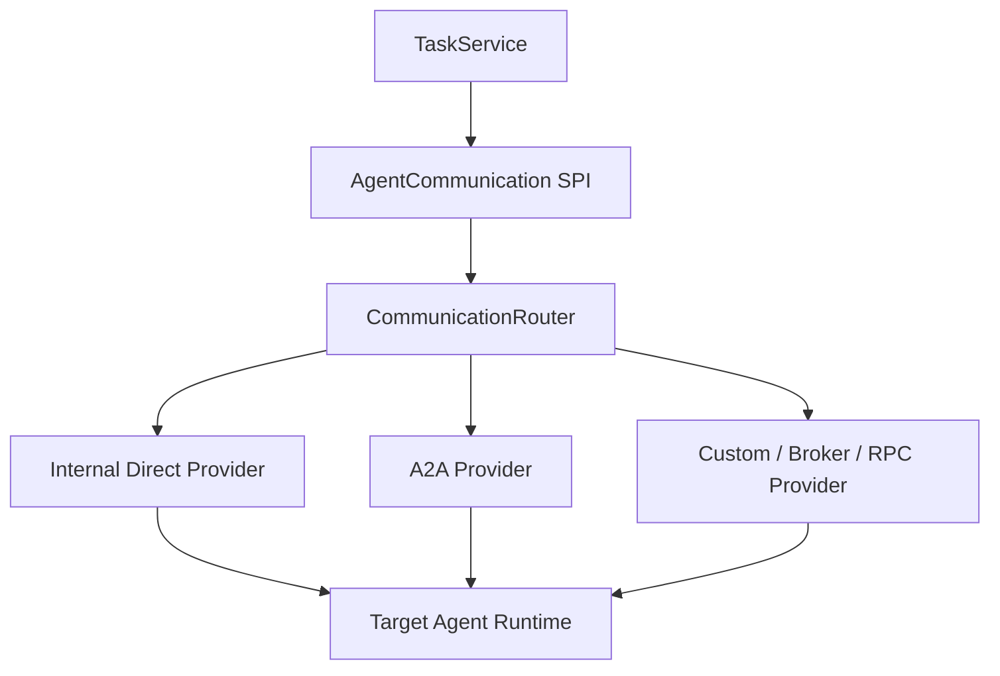

# Agentropy Communication Contract v1 — revision 5

**Status:** Accepted for M1 implementation of the router and direct provider (2026-11-05). A2A and custom providers are M2 (C-03/C-04). Behavior is claimed only where executable tests exist.  
**Decision:** [ADR-0015](../adr/0015-pluggable-agent-communication.md). **Errors:** [Errors v1](errors-v1.md).

## Revision history

| Rev | Date | Change |
|---|---|---|
| 1 | 2026-11-04 | Initial baseline |
| 2 | 2026-11-04 | Design review: AgentCommunication is an **outbound SPI of the TaskService**, not a handler API; every operation carries a `CallContext` (caller principal); duplicate `target` parameter removed from `delegate`; inbound path defined; remote task projection fields named |
| 3 | 2026-11-04 | Map ADR-0019 five logical families to existing v1 SPI and document extensions, declared guarantees and transport-neutral tracing |
| 4 | 2026-11-05 | Readiness closure: `CommunicationFeatures.durability` uses the canonical durability levels (`provider-dependent` counts as `none` for guarantee checks); `extensions` declaration formalized; `RouteRequirements` passed to `selectRoute`; `AgentRef` ↔ `VersionedRef` mapping stated; `AgentEvent` documented as a projection of `TaskEvent` |
| 5 | 2026-11-05 | FEAT-027.8 (C-03, C-04): A2A provider pinned to A2A protocol 1.0 (JSON-RPC binding) — outbound `A2ACommunicationProvider` and inbound `createA2AServer` — and the custom broker/RPC provider sample; both pass the shared conformance suite (see "M2 providers") |

## Position in the call stack

Handlers delegate through the `delegation` capability; the TaskService decides whether the target is local or remote. Only for **remote** targets (and for local targets when policy forces A2A) does it call the router. Inbound A2A requests terminate at an A2A server adapter that verifies the caller and calls `AgentService.delegate`. See the layering diagram in [Agent v1](agent-v1.md#call-layering).

For local, co-located targets the TaskService calls the runtime directly; the "internal/direct provider" exists so that the **same router conformance suite** can run without a network, and so a deployment can force all traffic through the router for uniform policy.

## Core principle

Agent handlers never see transports: they delegate through the `delegation` capability, and the TaskService uses the **AgentCommunication SPI** for remote targets. The CommunicationRouter selects a compatible, authorized provider. A2A is preferred for independently deployed agents, while local in-process communication and third-party/custom providers are equally valid implementations of the abstraction. Transport and protocol details never leak into Agent handlers.



## Interfaces (proposed TypeScript)

```ts
export interface AgentRef {
  definitionId: string;
  instanceId?: string;
  version?: string;
  tenantId: string;
  endpoint?: string;            // resolved by the registry for remote agents; never taken from message content
}

export interface CallContext {
  caller: TrustedPrincipal;     // verified by the TaskService before the router is called
  correlationId: string;
  causationId?: string;
  deadline?: string;
  signal?: AbortSignal;
}

export interface RouteBinding {        // persisted on the local task at acceptance; never re-selected
  providerId: string;
  protocol: string;
  protocolVersion: string;
  target: AgentRef;
}

export interface RemoteTaskRef {
  localTaskId: string;          // Agentropy projection record
  route: RouteBinding;
  remoteTaskId: string;
}

export type CommunicationOperation =
  | "delegate" | "send" | "getTask" | "cancel" | "subscribe";

export interface CommunicationFeatures {
  operations: readonly CommunicationOperation[];
  streaming: boolean;
  pushNotifications: boolean;
  /** Canonical levels (runtime contract); "provider-dependent" satisfies only a "none" requirement. */
  durability: "none" | "provider-dependent" | "durable-acceptance" | "durable-execution";
  protocol: string;
  protocolVersion: string;
  extensions?: readonly { id: string; version: string }[];   // optional, versioned, explicitly negotiated
}

export interface RouteRequirements {
  operations?: readonly CommunicationOperation[];          // all must be supported
  durability?: "none" | "durable-acceptance" | "durable-execution";
  extensions?: readonly string[];                           // mandatory extension IDs
}

/** Outbound SPI implemented by each provider. */
export interface AgentCommunicationProvider {
  readonly id: string;
  readonly features: CommunicationFeatures;
  supports(target: AgentRef, operation: CommunicationOperation): boolean;
  delegate<I>(route: RouteBinding, request: DelegationRequest<I>, ctx: CallContext): Promise<RemoteTaskRef>;
  send(route: RouteBinding, message: AgentMessage, ctx: CallContext): Promise<MessageReceipt>;
  getTask(ref: RemoteTaskRef, ctx: CallContext): Promise<RemoteTaskState>;
  cancel(ref: RemoteTaskRef, ctx: CallContext): Promise<RemoteTaskState>;
  subscribe(ref: RemoteTaskRef, ctx: CallContext): AsyncIterable<AgentEvent>;
}

/** Used only by the TaskService. Selects and pins a route, then delegates to the provider. */
export interface CommunicationRouter {
  register(provider: AgentCommunicationProvider): void;
  selectRoute(target: AgentRef, operation: CommunicationOperation, ctx: CallContext, requirements?: RouteRequirements): Promise<RouteBinding>;
  provider(route: RouteBinding): AgentCommunicationProvider;   // NoCompatibleRoute if unregistered
}

export interface RemoteTaskState {
  remoteState: string;          // provider's own state value, stored verbatim
  normalized: TaskSnapshot["status"] | "unknown";
  observedAt: string;
}

// References to Agentropy's existing contracts; no parallel task schema:
//   DelegationRequest, TaskSnapshot, TrustedPrincipal -> agent-v1.md
//   AgentMessage -> messaging-contract.md
export interface MessageReceipt { messageId: string; accepted: boolean; }
export interface AgentEvent { eventId: string; taskId: string; type: string; revision?: number; payload: unknown; }
```

`AgentRef.definitionId` + `version` correspond to Agent v1's `VersionedRef`; `tenantId` comes from the verified caller, and `endpoint` only from the registry. `AgentEvent` is the transport projection of the messaging contract's `TaskEvent` (same `eventId`, `taskId`, `revision`). Route selection fails `GuaranteeUnavailable` when no provider meets `requirements.durability`, and `UnsupportedOperation` when a required operation or extension is not declared.

Callers never see `RemoteTaskRef`: the public `TaskHandle`/`TaskSnapshot` always carry the **local** task ID, with `authority: "remote"` marking a projection. The TaskService keeps the `RouteBinding` and `RemoteTaskRef` on the task record.

## Logical communication families and v1 SPI coverage (ADR-0019)

The five families are **protocol-neutral semantics**, not five A2A endpoints or a promise that every adapter implements them. The current `CommunicationOperation` union intentionally contains only the **v1 implemented-by-design SPI surface**, and no additional method is silently implied:

| Family | Existing v1 SPI mapping | Support boundary |
|---|---|---|
| Message / request-response | `send` and `MessageReceipt` | Receipt acknowledges the declared transport acceptance only, not recipient processing or task creation |
| Message/progress streaming | `subscribe` as `AsyncIterable<AgentEvent>` for task events | Does **not** yet provide general bidirectional streaming messages; that requires a negotiated extension |
| Task delegation/lifecycle | `delegate`, `cancel` | Caller receives a local handle; remote authority and unknown-acceptance semantics retained |
| Inquiry/query | `getTask`; public `getResult` is owned by TaskService | A generic inquiry is **not** an extra mandatory v1 method; map a supported query or message/task interaction per provider |
| Subscription/notification/events | `subscribe`; `send` for explicitly supported non-task notifications | Push/webhook transport and durable notification guarantees remain optional/provider-declared |

**Extension contract (architectural rule, not an implemented TypeScript API):** Providers advertise distinct, versioned extension IDs and operation/guarantee capabilities during route selection. Unknown mandatory extensions or missing requirements fail with `UnsupportedOperation` / `GuaranteeUnavailable`; no silent fallback from streaming to polling, durable to best-effort, or authenticated to unauthenticated transport. Discovery through Registry and context continuation are optional extensions, not new mandatory SPI methods. Schema and SDK design for general message streaming and future A2A bindings are deferred.

**Delivery vs execution:** Best-effort is permissible only for explicitly noncritical progress/telemetry; task-changing commands and critical notifications require durable intent, idempotency and replay/reconciliation. A2A compatibility alone does not prove durable persistence. The provider's advertised guarantee must be verified and the remote task remains authoritative.

**Observability responsibility:** CommunicationProvider manages injection/extraction on the actual carrier; ObservabilityProvider owns span creation/export. W3C `traceparent`/`tracestate` are diagnostic context only, never identity, authority or an A2A-standard-required carrier across non-HTTP bindings.

## Provider routing rules

1. Resolve target definition/instance and registered endpoints using the Agent Registry.
2. Authenticate caller and enforce target/operation/tenant/delegated-scope authorization **before** route selection.
3. Filter providers by protocol version, supported operation, target compatibility, policy and required guarantees.
4. Prefer **A2A for independently addressable agents**, **direct for co-located agents** unless policy explicitly requires A2A; allow configured custom adapters.
5. Persist route ownership/remote task mapping for later status/cancel/subscription calls; do not reselect a different provider mid-task.
6. Fail with typed `NoCompatibleRoute`, `PermissionDenied`, `UnsupportedOperation`, `RemoteUnavailable` or `UnknownAcceptance` errors ([Errors v1](errors-v1.md)). No silent security/durability downgrade.

## Delivery and state semantics

- **Delegation acceptance** is separate from completion. A timeout after submission can leave acceptance unknown; reconcile by idempotency key rather than blindly retrying.
- **Local task authority:** Agentropy Task Service. **Remote task authority:** Remote agent/A2A server. Local tracking is a projection of remote state.
- **Task state mapping:** Keep remote state and local normalized status; do not assume A2A and Agentropy state enums are identical. Map terminal states explicitly, and represent unmapped states as unsupported/unknown rather than inventing transitions.
- **Streaming:** Optional. If unsupported, consumers can use polling where allowed; an API requesting streaming specifically gets an explicit unsupported response.
- **Security:** A2A endpoint authentication and end-user delegated authority are distinct. A provider cannot mint or infer user grants from message content.
- **Durability:** Direct provider may support durable acceptance only when the target service persists before acknowledging. A2A protocol support by itself does not imply persisted tasks or exactly-once effects.

## Conformance tests

- Same logical delegate/query/cancel behavior through internal and A2A providers.
- Registry discovery, routing precedence, custom provider registration and authorization.
- Provider operation support/unsupported errors and version negotiation.
- Duplicate request idempotency, unknown acceptance and remote task mapping.
- Streaming interruption, reconnect, out-of-order events and cancellation failure.
- Cross-tenant denial, forged identity, expired delegated grant, untrusted endpoint metadata.
- Durable acceptance only when persistence is proven.

## Open implementation choices

A2A SDK selection, protocol version, actual endpoint hosting, message serialization, routing persistence, broker implementation and runtime language are implementation ADR topics. The architecture decision does **not** claim those are already selected.

## M2 providers (FEAT-027.8)

Verified by `packages/testkit/test/a2a.test.ts` (shared conformance suite for both, plus A2A end-to-end, protocol and identity rules).

- **A2A (C-03), protocol 1.0, JSON-RPC binding** (`packages/runtime/src/a2a.ts`, pinned from the A2A specification 1.0.0; its `a2a.proto` is normative). Outbound: `SendMessage` (one text part; JSON input as `mediaType: application/json`; `messageId` = idempotency key, `contextId` = correlation ID; `returnImmediately`), `GetTask`, `CancelTask`; `A2A-Version: 1.0` on every call; a Bearer credential for this runtime resolved per call; no grant reference or caller identity is sent. State mapping: `SUBMITTED`→`created`, `WORKING`→`running`, `INPUT_REQUIRED`/`AUTH_REQUIRED`→`waiting`, `COMPLETED`, `FAILED`/`REJECTED`→`failed`, `CANCELED`→`cancelled`. Errors: A2A codes −32001 (`NotFound`), −32002 (`InvalidState`), −32004 (`UnsupportedOperation`), −32005 (`SchemaViolation`), −32009 (`IncompatibleVersion`); an Agentropy peer also returns the Errors v1 shape in `error.data`. Inbound: `createA2AServer(target, { instanceId })` with the transport's authenticated principal (unauthenticated → HTTP 401), over `localAppTarget(app)` so every AgentService PEP applies; completed tasks carry the output as an artifact. `a2aAgentCard` builds the card. Not in v1: streaming and `SubscribeToTask` (`subscribe` polls `GetTask`), push notifications, `ListTasks`, task continuation, file parts.
- **Custom provider sample (C-04)** (`packages/examples/src/broker-provider.ts`): the same SPI over any request/response broker, with an in-memory broker standing in for NATS, RabbitMQ, Kafka request-reply or gRPC; the serving side uses only the identity the broker stamps on a request.
- **Remote targets in `delegation.delegate`** (local projection tasks driven by the router) are not wired yet: providers are used directly or by applications. Tracked as FEAT-027.9.
