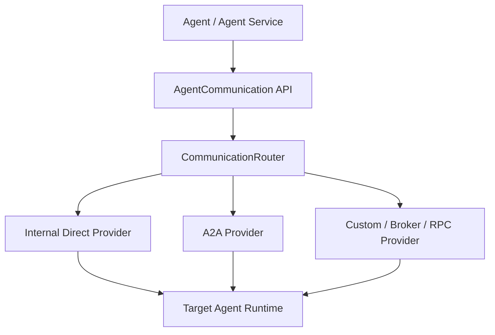

# Agentropy Communication Contract v1 — Architecture baseline

**Status:** Agreed architecture direction; interface design proposed for implementation validation. **No implementation exists yet.**  
**Decision:** [ADR-0015](../adr/0015-pluggable-agent-communication.md).

## Core principle

Agents depend only on a **logical AgentCommunication API**. The CommunicationRouter selects a compatible, authorized provider. A2A is preferred for independently deployed agents, while local in-process communication and third-party/custom providers are equally valid implementations of the abstraction. Transport and protocol details never leak into Agent handlers.



## Interfaces (proposed TypeScript)

```ts
export interface AgentRef {
  definitionId: string;
  instanceId?: string;
  version?: string;
  tenantId: string;
}

export interface TaskRef {
  taskId: string;
  providerId: string;
  remoteTaskId?: string;
}

export type CommunicationOperation =
  | "delegate" | "send" | "getTask" | "cancel" | "subscribe";

export interface CommunicationFeatures {
  operations: readonly CommunicationOperation[];
  streaming: boolean;
  pushNotifications: boolean;
  durability: "none" | "provider-dependent" | "durable-acceptance";
  protocol: string;
  protocolVersion: string;
}

export interface AgentCommunication {
  delegate<I>(target: AgentRef, request: DelegationRequest<I>): Promise<TaskHandle>;
  send(target: AgentRef, message: AgentMessage): Promise<MessageReceipt>;
  getTask(ref: TaskRef): Promise<TaskSnapshot>;
  cancel(ref: TaskRef): Promise<void>;
  subscribe(ref: TaskRef): AsyncIterable<AgentEvent>;
}

export interface AgentCommunicationProvider extends AgentCommunication {
  readonly id: string;
  readonly features: CommunicationFeatures;
  supports(target: AgentRef, operation: CommunicationOperation): boolean;
}

export interface CommunicationRouter extends AgentCommunication {
  register(provider: AgentCommunicationProvider): void;
}

// References to Agentropy's existing contracts; no parallel task schema:
export type DelegationRequest<I> = import("./agent-v1").DelegationRequest<I>;
export type TaskHandle = import("./agent-v1").TaskHandle;
export type TaskSnapshot = import("./agent-v1").TaskSnapshot;
export type AgentMessage = import("../messaging-contract").AgentMessage;
export interface MessageReceipt { messageId: string; accepted: boolean; }
export interface AgentEvent { eventId: string; taskId: string; type: string; payload: unknown; }
```

The import paths are documentation references, not compiled TypeScript modules. Provider-specific IDs are tracked by the router; public task references must be resolved to their authoritative owner. Avoid adding a `providerId` requirement to the existing public `TaskHandle` until routing and remote-task mapping are validated.

## Provider routing rules

1. Resolve target definition/instance and registered endpoints using the Agent Registry.
2. Authenticate caller and enforce target/operation/tenant/delegated-scope authorization **before** route selection.
3. Filter providers by protocol version, supported operation, target compatibility, policy and required guarantees.
4. Prefer **A2A for independently addressable agents**, **direct for co-located agents** unless policy explicitly requires A2A; allow configured custom adapters.
5. Persist route ownership/remote task mapping for later status/cancel/subscription calls; do not reselect a different provider mid-task.
6. Fail with typed `NoCompatibleRoute`, `Unauthorized`, `UnsupportedOperation`, `RemoteUnavailable` or `UnknownAcceptance` errors. No silent security/durability downgrade.

## Delivery and state semantics

- **Delegation acceptance** is separate from completion. A timeout after submission can leave acceptance unknown; reconcile by idempotency key rather than blindly retrying.
- **Local task authority:** Agentropy Task Service. **Remote task authority:** Remote agent/A2A server. Local tracking is a projection of remote state.
- **Task state mapping:** Keep remote state and local normalized status; do not assume A2A and Agentropy state enums are identical. Map terminal states explicitly, and represent unmapped states as unsupported/unknown rather than inventing transitions.
- **Streaming:** Optional. If unsupported, consumers can use polling where allowed; an API requesting streaming specifically gets an explicit unsupported response.
- **Security:** A2A endpoint authentication and end-user delegated authority are distinct. A provider cannot mint or infer user grants from message content.
- **Durability:** Direct provider may support durable acceptance only when the target service persists before acknowledging. A2A protocol support by itself does not imply persisted tasks or exactly-once effects.

## Conformance tests

- Same logical delegate/query/cancel behavior through internal and A2A providers.
- Registry discovery, routing precedence, custom provider registration and authorization.
- Provider operation support/unsupported errors and version negotiation.
- Duplicate request idempotency, unknown acceptance and remote task mapping.
- Streaming interruption, reconnect, out-of-order events and cancellation failure.
- Cross-tenant denial, forged identity, expired delegated grant, untrusted endpoint metadata.
- Durable acceptance only when persistence is proven.

## Open implementation choices

A2A SDK selection, protocol version, actual endpoint hosting, message serialization, routing persistence, broker implementation and runtime language are implementation ADR topics. The architecture decision does **not** claim those are already selected.
