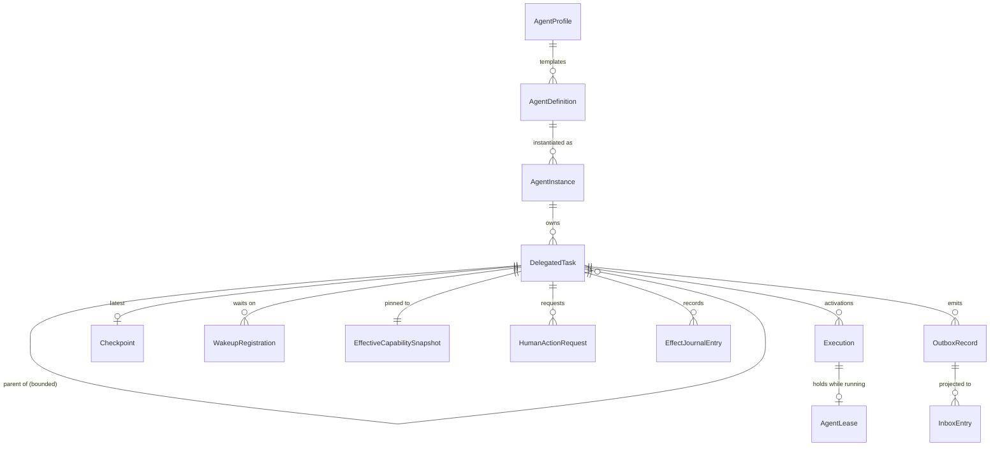

# Agent domain model

**Authoritative sources:** types in [Agent v1](contracts/agent-v1.md) and [Capability v1](contracts/capability-v1.md); states and edges in the [runtime contract](runtime-contract.md). This page is the entity map and glossary; it deliberately contains **no** type definitions or state lists of its own (revision 1 duplicated both and drifted).

## Entities

| Entity | Key fields | Purpose | Lifetime |
|---|---|---|---|
| AgentDefinition | `id`, `version`, `profile`, capability selections, schemas, `policyRef` | Immutable versioned blueprint | Forever (versions immutable) |
| AgentProfile | `id`, `version`, required/defaults/optional | Reusable capability template | Forever |
| AgentInstance | `id`, `definition`, `tenantId`, `ownerId`, `state`, `revision` | Logical, owner-scoped agent identity, independent of any process | Until retired; history kept |
| DelegatedTask | `taskId`, `parentTaskId`, `retryOf`, `agentInstanceId`, `principal`, input, `status`, `revision`, `deadline`, `budget`, version snapshot, `authority`, route binding (remote) | Bounded obligation; also the unit for long-lived responsibilities | Until terminal; retained per policy |
| Execution | `executionId`, `taskId`, `activation`, `attempt`, `trigger`, `state`, `leaseEpoch`, timestamps | One activation of the handler | Seconds–minutes; always terminates |
| Checkpoint | `taskId`, `revision`, codec, payload ref | Handler state between activations | Latest kept; older pruned per policy |
| WakeupRegistration | `id`, `taskId`, condition, `dueAt`, `status` (`armed`/`fired`/`revoked`) | Durable wake-up intent; the scheduler/event layer reads only this | Until fired or revoked |
| EffectiveCapabilitySnapshot | `snapshotId`, bindings, `policyRef` | Exact resolved capability/provider versions pinned to a task | Immutable |
| EffectJournalEntry | `idempotencyKey`, `taskId`, `stepKey`, result ref | Records completed external effects for replay safety | Retained ≥ task lifetime |
| OutboxRecord | `eventId`, aggregate id + `revision`, type, payload, `publishedAt`, lease | Transactional event publication | Until published + retention |
| HumanActionRequest | `requestId`, `taskId`, kind, schema, assignees, `dueAt`, `status`, `revision` | Typed approval/input request | Until resolved/expired/revoked |
| InboxEntry | `entryId`, `userId`, `tenantId`, source event ref, category, effective priority, delivery markers | User-scoped projection of significant events | Retention policy |
| AgentLease | `leaseId`, `executionId`, `epoch`, `expiresAt` | Short-lived execution capacity grant | Seconds–minutes |

IDs are opaque and unambiguous within the tenancy namespace. Every state-changing envelope carries actor identity, delegated authority, trace context and an idempotency key.

## Relationships

## Long-lived responsibilities

A monitoring or "always-on" agent's standing duty is a **non-terminal task** that cycles `waiting → assigned → running → waiting`. Each cycle is a new Execution; the checkpoint carries what must be remembered between cycles; a wake-up registration (schedule/event) carries what wakes it. It ends only by `completed` (condition met), `cancelled` (user) or `failed`. See [ADR-0018](adr/0018-execution-per-activation.md).

## Glossary

| Term | Meaning |
|---|---|
| Activation | One run of a handler for a task (= one Execution). Triggered by delegation, wake-up or retry |
| Attempt | Retry counter within an activation after a retryable failure or lost lease |
| Correlation ID | Groups everything caused by one user intent across tasks and agents |
| Causation ID | The message/event that directly caused this one |
| Delegated authority | The grant chain under which an agent acts for a principal; narrowed at each hop |
| Effective priority | Output of the priority resolver ([human actions](human-actions.md)) |
| Projection | A read model derived from authoritative events (inbox entries, remote task records) that never drives state |
| Revision | Monotonic per-entity integer used for compare-and-swap and event ordering |
| Step key | Deterministic handler-chosen name for an external effect; basis of its idempotency key |
| Wake-up | A durable condition (timer, schedule, event, human action, child tasks) that reactivates a waiting task |
