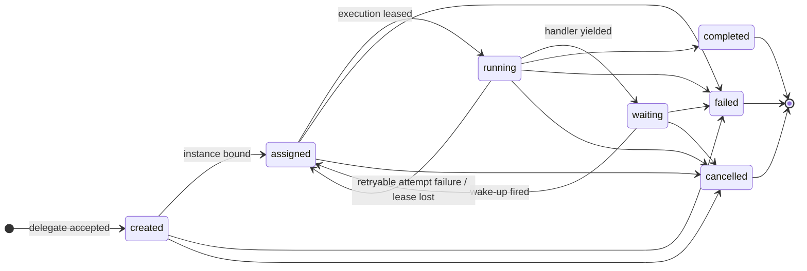

# Agent task lifecycle, durability and version compatibility

**Status:** proposed contract design, **revision 3 (2026-11-05)**. Revision 3 (FEAT-022) adds the T6 gate-deferral case, records the implemented ADR-0024 gate and the checkpoint size bound. Revision 2 replaces the prose state sketches with explicit transition tables, adopts the *one execution per activation* model ([ADR-0018](adr/0018-execution-per-activation.md)), and fixes the retry ambiguity. This document is the **single authoritative source** for lifecycle states and edges; other documents link here instead of restating them.

Adapted from langgraph-flows' fixed FlowRun transition rules, async-first run semantics and version-pinned durable execution. It does **not** copy the Flow type system.

## Lifecycle authority

- Only the **TaskService/AgentRuntime** applies transitions. Handlers return a disposition; tools, transports, the inbox and conversational code never write lifecycle state.
- Every transition is a compare-and-swap on the entity `revision` (monotonic integer). A transition whose expected revision is stale fails with `StaleRevision` and has no side effects.
- Every applied transition emits exactly one committed lifecycle event (via the outbox) carrying the new revision.
- Any edge not listed in the tables below is illegal and fails with `InvalidState`. Error codes are defined in [Errors v1](contracts/errors-v1.md).

## Four lifecycles

### 1. DelegatedTask

| # | From | To | Trigger | Guard / effect |
|---|---|---|---|---|
| T1 | — | `created` | `delegate` accepted | Authorization, schema, capability resolution and idempotency check pass; version snapshot persisted |
| T2 | `created` | `assigned` | Instance bound | Target instance `available` (or created on demand); execution queued |
| T3 | `assigned` | `running` | Execution leased | Pool granted a lease; execution moves to `running` |
| T4 | `running` | `waiting` | Handler returned `waiting` | Checkpoint **and** wake-up registration committed in the same transaction **before** the lease is released |
| T5 | `waiting` | `assigned` | Wake-up fired | Wake-up registration consumed atomically (dedup); new execution queued with `trigger: "resume"` |
| T6 | `running` | `assigned` | Attempt failed `retryable: true`, handler threw, or lease lost | `attempt < retryPolicy.maxAttempts`; backoff per `retryPolicy`; new execution queued with same `activation`, `attempt + 1` |
| T6 (gate) | `running` | `assigned` | A protected effect was refused with `AuthorityExpired` or `PolicyDecisionUnavailable` | Not a handler failure: `attempt` unchanged and not counted against `maxAttempts`; new execution queued; the ADR-0024 gate holds it until a fresh decision (policy outage) or reauthorization (lost grant) |
| T7 | `running` | `completed` | Handler returned `completed` | Output validated against `outputSchema` |
| T8 | `running` | `failed` | Handler returned `failed` non-retryable, attempts exhausted, output invalid, or `IncompatibleVersion` | Typed failure recorded |
| T9 | `created`, `assigned`, `waiting` | `failed` | Task deadline passed; wake-up `timeoutAt` passed with `onTimeout: "fail"`; awaited human action expired with `onExpiry: "fail-task"` | Queued execution aborted (E7); registrations revoked |
| T10 | `created`, `assigned`, `waiting` | `cancelled` | `cancel`, or instance retired with `force` | Queued execution aborted (E7); registrations and event subscriptions revoked |
| T11 | `running` | `cancelled` | `cancel` | `cancelRequestedAt` set and `AbortSignal` fired first; transition applies when the execution ends **or** `cancelGracePeriod` (runtime setting, default 30 s) expires; the execution is then fenced as `lost` (E8) |

**Operational limits (D-05):** every bound above (pool size, lease, cancel grace, execution history, checkpoint size, PDP timeout, delegation depth and fan-out, mailbox size, gate retry) is one validated `RuntimeLimits` value (`packages/runtime/src/limits.ts`, defaults in `DEFAULT_LIMITS`); invalid values fail at startup with `InvalidConfiguration` naming the field.

**Leases, back-pressure and compaction (M2-01, FEAT-027.4):** a worker renews the lease of every execution it is still running on each scheduler tick (heartbeat), so other workers recover only executions whose worker stopped. A subscription mailbox holds at most `mailboxLimit` unconsumed events (default 1000); further events are not appended for that subscription and are counted on it (`dropped`). `compact(retainMs)` removes consumed mailbox rows, dedupe records older than the window, and published outbox rows and wake-ups of tasks that ended before it; a `subscribe` on such a task ends instead of waiting. See the [scale baseline](review/2026-11-05-m2-scale-baseline.md).

**Bounded state (R-37):** a `waiting` disposition whose serialized checkpoint exceeds the runtime's `maxCheckpointBytes` (default 64 KiB) is refused as `SchemaViolation` (`reason: checkpointTooLarge`) and the task fails; execution history keeps the last `keepExecutions` (default 20) finished executions per task (AC-20).

**Counters:** `activation` is 1 for the first execution and increments on each wake-up (T5); `attempt` starts at 1 per activation and increments on each T6. A retry is not a new activation.

**Retry policy:** `AgentDefinition.retryPolicy` (`maxAttempts`, default 3; `backoff` exponential from 1 s, max 5 min), overridable downward per delegation. A thrown exception is treated as `retryable: true`; a returned `failed` disposition decides for itself.

`completed`, `failed`, `cancelled` are terminal. **Retrying a terminal task creates a new task** with `retryOf: <taskId>`; terminal tasks are never reopened. Execution-level recovery (T6) happens inside the same non-terminal task.

`cancel` on a `running` task is a request, not an instant state: the task stays `running` with `cancelRequestedAt` until T11. Cancellation never claims rollback of committed external effects.

### 2. Execution (one per run)

An Execution is a single run of a handler for a task: initial start, each wake-up and each retry each create a **new** Execution, identified by its `activation` and `attempt` counters. Executions are short-lived and always end in a terminal state; long waits live on the task, not on an execution. See [ADR-0018](adr/0018-execution-per-activation.md).

| # | From | To | Trigger | Guard / effect |
|---|---|---|---|---|
| E1 | — | `queued` | Task T2/T5/T6 | `trigger`: `delegation` \| `resume` \| `retry` |
| E2 | `queued` | `leased` | Pool grant | Lease with `epoch` (fencing token) recorded |
| E3 | `leased` | `running` | Handler invoked | Lease epoch matches |
| E4 | `running` | `succeeded` | Disposition `completed` | Applied together with T7 |
| E5 | `running` | `yielded` | Disposition `waiting` | Applied together with T4 |
| E6 | `running` | `failed` | Disposition `failed` or handler threw | Applied together with T6 or T8 |
| E7 | `queued`, `leased` | `aborted` | Task left a runnable state (T9, T10) before the handler started | No handler involvement |
| E7b | `running` | `aborted` | Cancel requested and handler returned after observing `AbortSignal` | Applied together with T11; any returned disposition is discarded |
| E8 | `leased`, `running` | `lost` | Lease expired, worker crashed, or `cancelGracePeriod` expired | Any later write carrying the old epoch is rejected (`StaleRevision`) |

Terminal: `succeeded`, `yielded`, `failed`, `aborted`, `lost`.

### 3. AgentInstance

| From | To | Trigger | Effect |
|---|---|---|---|
| — | `available` | Instance created | Effective capability snapshot persisted |
| `available` | `suspended` | Operator/owner suspend | New delegations fail `InstanceUnavailable`; due wake-ups are **deferred**, not dropped |
| `suspended` | `available` | Resume | Deferred wake-ups fire |
| `available`, `suspended` | `retired` | Retire | Without `force`: fails `InvalidState` while non-terminal tasks exist. With `force`: cancels them (T10/T11). History retained |

The earlier `registered` state is removed: registration applies to **definitions**, not instances.

### 4. HumanActionRequest

`pending → claimed → resolved | expired | revoked`, `pending → resolved | expired | revoked`, `claimed → pending` (claim released or expired). Full rules in [human actions](human-actions.md).

## Security wait and policy recovery — ADR-0024 accepted alignment (2026-11-04)

**This note aligns ADR-0021 with the existing v1 lifecycle; it does not introduce a new state or transition.** `authorization-blocked`, `policy-waiting`, and `revocation-blocked` are **reason classifications**, not valid persisted `DelegatedTask.status` values. The only appropriate existing non-terminal durable wait state is `waiting`, reached through T4 when a running handler safely yields with a checkpoint and an armed wake-up. A retryable PDP outage is not itself proof that a business task failed.

- **Before T1 acceptance:** lack of authenticated/authorized acceptance is a typed refusal; no task is created. A request rejected before acceptance is not inserted into `waiting`.
- **Already `running`:** where the runtime can safely suspend *before any protected effect is dispatched*, handler/runtime yields through T4 with a redacted `waitingOn` reason and an authorized policy/reauthorization wake-up. T4 still requires the atomic checkpoint + wake registration. A revocation during an already-dispatched external effect cannot be treated as an immediate yield; reconcile confirmed/unknown effect outcome and apply cooperative cancellation when supported.
- **Already `created`/`assigned`/`waiting`:** do not invent direct T4 edges. Guard starting the next execution; if authorization cannot be established, keep pending work durably and use an existing deferred wake-up/scheduling mechanism. **Accepted ADR-0024** resolves the design direction: use a durable, non-lifecycle activation-eligibility gate with an eligibility time, classified block reason and revision/fencing checks, retaining the task status (`created`/`assigned`) without issuing an execution lease. A PDP outage schedules bounded backoff; revoked/expired grants wait for independently authorized renewal. ADR-0024 now specifies a minimal scheduler-owned gate shape (`gateRevision`, `taskRevision`, `reason`, optional `nextCheckAt`, opaque `grantRef`) and atomic eligibility/lease checks. Implemented in FEAT-022.2 (`packages/runtime/src/runtime.ts`, store collection `gates`) and verified by `packages/testkit/test/security.test.ts` (SEC-01/02): persistence across restart, bounded retries, CAS between schedulers, cancel and deadline while gated, reauthorization with a fresh policy decision. A failed grant must never be converted into a successful task completion.
- **On recovery:** only T5 or the defined runnable route can resume, with fresh principal/delegation/policy validation at sensitive boundaries, idempotent step keys and explicit audit. Scope/expiry revocation cannot be bypassed by the pinned version/configuration snapshot.
- **Timeout/terminal disposition:** use existing T9 or an authorized cancel path only when its stated guards actually apply. A policy wait does not silently create a new terminal edge. Alert/operator handling and maximum waiting time are configurable subject to governance.

A same-fingerprint idempotency replay may reveal only the original outcome to a currently authorized requester; it does **not** grant authority to repeat a side effect or authorize access after revocation. For details see [ADR-0021](adr/0021-delegated-authorization.md) and the [security review](review/2026-11-04-security-governance-closeout.md).

## Operation guards

Guards are evaluated **before** any adapter is invoked, in this order:

1. **Authenticate** (`Unauthenticated`) → 2. **authorize** incl. tenant and grant (`PermissionDenied`, `TenantMismatch`, `AuthorityExpired`; invisible targets → `NotFound`) → 3. **schema** (`SchemaViolation`) → 4. **idempotency replay**: a known key with the same fingerprint returns the stored result immediately; a different fingerprint fails `IdempotencyConflict` → 5. **entity state** (`InvalidState`, `InstanceUnavailable`, human-action state) → 6. **capability/guarantee/route** → 7. **limits** (depth, fan-out, quota).

Replay before state means a retry of an already-accepted request always gets its original answer, even if state or configuration changed since. A missing capability never degrades to a no-op.

| Operation | Allowed task states | Required capability / guarantee | Typed refusals |
|---|---|---|---|
| `delegate` | n/a (creates) | Target resolves; required guarantees available | `Unauthenticated`, `PermissionDenied`, `TenantMismatch`, `AuthorityExpired`, `NotFound`, `SchemaViolation`, `IdempotencyConflict`, `InstanceUnavailable`, `CapabilityUnavailable`, `GuaranteeUnavailable`, `NoCompatibleRoute`, `DelegationDepthExceeded`, `FanOutExceeded`, `QuotaExceeded` |
| `getTask` | any | Read authorization | `PermissionDenied`, `NotFound` |
| `getResult` | `completed` | Read authorization | `NotReady` (non-terminal), `TaskFailed`/`TaskCancelled` (terminal, with outcome) |
| `cancel` | `created`, `assigned`, `running`, `waiting` | Cancellable (all v1 tasks are; downstream stop is best-effort) | `InvalidState` on terminal |
| `provideHumanInput` | Checked on the **request**, not the task: request `pending`/`claimed` accepts; request `resolved` with the same decision fingerprint returns the original outcome (no-op); different decision → `ActionConflict`. Task must still be `waiting` on it to resume | `human-input` capability | `NotAssignee`, `StaleRevision`, `ActionConflict`, `ActionExpired`, `ActionRevoked` |
| `pause` / `resume` | **Not in v1.** Instance-level `suspend` covers the POC need | — | `UnsupportedOperation` |
| `retry` | `failed`, `cancelled` | Retry policy permits | `InvalidState`; creates a new task |

## Event subscriptions (no lost events between activations)

An `event-handling.subscribe` call creates a **durable per-task subscription** (persisted, survives restart) that outlives individual wake-ups. Matching events are appended to the task's **event mailbox** in the same transaction that records the inbound event, whether or not the task is currently waiting. A `{ kind: "event" }` wake-up condition fires as soon as the mailbox holds an unconsumed matching event — immediately at T4 if one arrived while the task was running. Each resume consumes exactly the **oldest** pending event (delivered inline in `wakeReason.payload`). Duplicate deliveries of the same inbound event ID are dropped at append time. Subscriptions are revoked on any terminal transition or `unsubscribe`.

## Async-first result

`delegate` returns a `TaskHandle` after validation and durable acceptance, never the final result. A transport timeout leaves acceptance **unknown**; the caller resolves it by re-sending the same request with the same idempotency key (returns the original handle) or by `getTaskByIdempotencyKey`. `executeAndWait(timeout)` is a client-side convenience over `delegate` + subscribe/poll; on timeout it returns the handle, not an error, and the task continues.

## Durability levels

A runtime/provider declares exactly one level per [Capability v1](contracts/capability-v1.md#guarantees):

| Level | What survives a process restart | Allowed for |
|---|---|---|
| `none` | Nothing. Restart loses accepted tasks; `getTask` returns `NotFound` | Tests, ephemeral helpers; must be disclosed on the handle |
| `durable-acceptance` | Accepted task record and its input | Immediate tasks that may be re-run from scratch |
| `durable-execution` | Task, checkpoints, wake-up registrations, outbox, version snapshot | `waiting`, monitoring, approvals — anything that outlives one activation |

A definition requiring `durable-execution` cannot be bound to a weaker runtime (`GuaranteeUnavailable`). Side effects may repeat after a crash; [step keys](contracts/agent-v1.md#idempotent-side-effects) make them idempotent.

## Version pinning and upgrade

On acceptance (T1), snapshot **definition version, profile version, exact capability contract versions, provider id/version, input schema version and policy version**, plus (Agent v1 revision 7) the implementation binding, tool pins and skill pins — all recorded as one [`AcceptanceSnapshot`](contracts/agent-v1.md#acceptance-snapshot-revision-7). Each new Execution of the task runs against the snapshot. Instances may adopt newer definitions for **future** tasks only. If the runtime cannot load a compatible handler for a snapshot (removed version, incompatible checkpoint codec), the execution fails with `IncompatibleVersion` and the task follows T8 — never a silent upgrade. Replay-based providers additionally need worker version routing; pinning a string does not guarantee replay safety.

## Required contract tests

- Every legal edge in each table, and a generated test that every *unlisted* edge is rejected with `InvalidState`.
- Guard ordering: unauthorized + invalid state reports `PermissionDenied`, not `InvalidState` (no state leakage).
- Acceptance, unknown-acceptance by idempotency key, `getResult` before completion.
- Crash while `waiting`; crash while `running` (T6 via E8); stale-epoch write rejected after lease loss.
- Duplicate wake-up delivery consumes the registration once (T5); events published while the task is `running` are delivered on the next activation, in order.
- Cancel during `running` with a handler that ignores abort → grace expiry → `lost` + `cancelled`.
- V1 task waiting across a V2 definition rollout; removed V1 handler → `IncompatibleVersion`.
- `durability: none` task discloses loss after restart.
