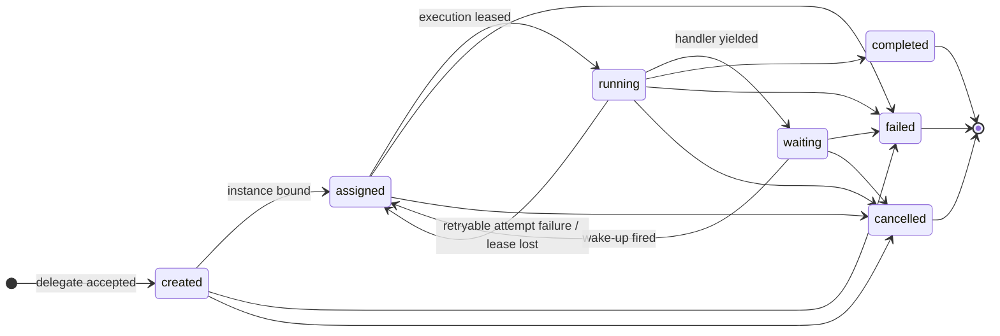

# Agent task lifecycle, durability and version compatibility

**Status:** proposed contract design, **revision 2 (2026-11-04)**. Revision 2 replaces the prose state sketches with explicit transition tables, adopts the *one execution per activation* model ([ADR-0018](adr/0018-execution-per-activation.md)), and fixes the retry ambiguity. This document is the **single authoritative source** for lifecycle states and edges; other documents link here instead of restating them.

Adapted from langgraph-flows' fixed FlowRun transition rules, async-first run semantics and version-pinned durable execution. It does **not** copy the Flow type system.

## Lifecycle authority

- Only the **TaskService/AgentRuntime** applies transitions. Handlers return a disposition; tools, transports, the inbox and conversational code never write lifecycle state.
- Every transition is a compare-and-swap on the entity `revision` (monotonic integer). A transition whose expected revision is stale fails with `StaleRevision` and has no side effects.
- Every applied transition emits exactly one committed lifecycle event (via the outbox) carrying the new revision.
- Any edge not listed in the tables below is illegal and fails with `InvalidState`. Error codes are defined in [Errors v1](contracts/errors-v1.md).

## Four lifecycles

### 1. DelegatedTask

| # | From | To | Trigger | Guard / effect |
|---|---|---|---|---|
| T1 | — | `created` | `delegate` accepted | Authorization, schema, capability resolution and idempotency check pass; version snapshot persisted |
| T2 | `created` | `assigned` | Instance bound | Target instance `available` (or created on demand); execution queued |
| T3 | `assigned` | `running` | Execution leased | Pool granted a lease; execution moves to `running` |
| T4 | `running` | `waiting` | Handler returned `waiting` | Checkpoint **and** wake-up registration committed in the same transaction **before** the lease is released |
| T5 | `waiting` | `assigned` | Wake-up fired | Wake-up registration consumed atomically (dedup); new execution queued with `trigger: "resume"` |
| T6 | `running` | `assigned` | Attempt failed `retryable: true`, or lease lost | Attempt budget not exhausted; backoff applied; new execution queued |
| T7 | `running` | `completed` | Handler returned `completed` | Output validated against `outputSchema` |
| T8 | `running` | `failed` | Handler returned `failed` non-retryable, attempt budget exhausted, or output invalid | Typed failure recorded |
| T9 | `created`, `assigned`, `waiting` | `failed` | Deadline passed, instance retired, wake-up expired with `onTimeout: "fail"` | — |
| T10 | `created`, `assigned`, `waiting` | `cancelled` | `cancel` | Pending executions dropped; wake-up registrations revoked |
| T11 | `running` | `cancelled` | `cancel` | `cancelRequestedAt` set and `AbortSignal` fired first; transition applies when the execution ends **or** the abort grace period expires (execution then fenced as `lost`) |

`completed`, `failed`, `cancelled` are terminal. **Retrying a terminal task creates a new task** with `retryOf: <taskId>`; terminal tasks are never reopened. Execution-level recovery (T6) happens inside the same non-terminal task.

`cancel` on a `running` task is a request, not an instant state: the task stays `running` with `cancelRequestedAt` until T11. Cancellation never claims rollback of committed external effects.

### 2. Execution (one per activation)

An Execution is a single activation of a handler for a task: initial start, each wake-up and each retry each create a **new** Execution with `attempt` and `activation` counters. Executions are short-lived and always end in a terminal state; long waits live on the task, not on an execution. See [ADR-0018](adr/0018-execution-per-activation.md).

| # | From | To | Trigger | Guard / effect |
|---|---|---|---|---|
| E1 | — | `queued` | Task T2/T5/T6 | `trigger`: `delegation` \| `resume` \| `retry` |
| E2 | `queued` | `leased` | Pool grant | Lease with `epoch` (fencing token) recorded |
| E3 | `leased` | `running` | Handler invoked | Lease epoch matches |
| E4 | `running` | `succeeded` | Disposition `completed` | Applied together with T7 |
| E5 | `running` | `yielded` | Disposition `waiting` | Applied together with T4 |
| E6 | `running` | `failed` | Disposition `failed` or handler threw | Applied together with T6 or T8 |
| E7 | `queued`, `leased`, `running` | `aborted` | Task cancelled and handler observed abort | Applied together with T10/T11 |
| E8 | `leased`, `running` | `lost` | Lease expired / worker crashed | Any later write carrying the old epoch is rejected (`StaleRevision`) |

Terminal: `succeeded`, `yielded`, `failed`, `aborted`, `lost`.

### 3. AgentInstance

| From | To | Trigger | Effect |
|---|---|---|---|
| — | `available` | Instance created | Effective capability snapshot persisted |
| `available` | `suspended` | Operator/owner suspend | New delegations fail `InstanceUnavailable`; due wake-ups are **deferred**, not dropped |
| `suspended` | `available` | Resume | Deferred wake-ups fire |
| `available`, `suspended` | `retired` | Retire | Allowed only when no non-terminal tasks remain, or with `force` which cancels them (T10/T11). History retained |

The earlier `registered` state is removed: registration applies to **definitions**, not instances.

### 4. HumanActionRequest

`pending → claimed → resolved | expired | revoked`, `pending → resolved | expired | revoked`, `claimed → pending` (claim released or expired). Full rules in [human actions](human-actions.md).

## Operation guards

Guards are evaluated **before** any adapter is invoked, in this order: authenticate → authorize → state → capability → idempotency. A missing capability never degrades to a no-op.

| Operation | Allowed task states | Required capability / guarantee | Typed refusals |
|---|---|---|---|
| `delegate` | n/a (creates) | Target resolves; required guarantees available | `PermissionDenied`, `SchemaViolation`, `CapabilityUnavailable`, `GuaranteeUnavailable`, `IdempotencyConflict`, `DelegationDepthExceeded`, `FanOutExceeded` |
| `getTask` | any | Read authorization | `PermissionDenied`, `NotFound` |
| `getResult` | `completed` | Read authorization | `NotReady` (non-terminal), `TaskFailed`/`TaskCancelled` (terminal, with outcome) |
| `cancel` | `created`, `assigned`, `running`, `waiting` | Cancellable (all v1 tasks are; downstream stop is best-effort) | `InvalidState` on terminal |
| `provideHumanInput` | `waiting` on that exact request | `human-input` capability | `ActionExpired`, `ActionRevoked`, `ActionConflict`, `NotAssignee`, `StaleRevision` |
| `pause` / `resume` | **Not in v1.** Instance-level `suspend` covers the POC need | — | `UnsupportedOperation` |
| `retry` | `failed`, `cancelled` | Retry policy permits | `InvalidState`; creates a new task |

## Async-first result

`delegate` returns a `TaskHandle` after validation and durable acceptance, never the final result. A transport timeout leaves acceptance **unknown**; the caller resolves it by re-sending the same request with the same idempotency key (returns the original handle) or by `getTaskByIdempotencyKey`. `executeAndWait(timeout)` is a client-side convenience over `delegate` + subscribe/poll; on timeout it returns the handle, not an error, and the task continues.

## Durability levels

A runtime/provider declares exactly one level per [Capability v1](contracts/capability-v1.md#guarantees):

| Level | What survives a process restart | Allowed for |
|---|---|---|
| `none` | Nothing. Restart loses accepted tasks; `getTask` returns `NotFound` | Tests, ephemeral helpers; must be disclosed on the handle |
| `durable-acceptance` | Accepted task record and its input | Immediate tasks that may be re-run from scratch |
| `durable-execution` | Task, checkpoints, wake-up registrations, outbox, version snapshot | `waiting`, monitoring, approvals — anything that outlives one activation |

A definition requiring `durable-execution` cannot be bound to a weaker runtime (`GuaranteeUnavailable`). Side effects may repeat after a crash; [step keys](contracts/agent-v1.md#idempotent-side-effects) make them idempotent.

## Version pinning and upgrade

On acceptance (T1), snapshot **definition version, profile version, exact capability contract versions, provider id/version, input schema version and policy version**. Each new Execution of the task runs against the snapshot. Instances may adopt newer definitions for **future** tasks only. If the runtime cannot load a compatible handler for a snapshot (removed version, incompatible checkpoint codec), the execution fails with `IncompatibleVersion` and the task follows T8 — never a silent upgrade. Replay-based providers additionally need worker version routing; pinning a string does not guarantee replay safety.

## Required contract tests

- Every legal edge in each table, and a generated test that every *unlisted* edge is rejected with `InvalidState`.
- Guard ordering: unauthorized + invalid state reports `PermissionDenied`, not `InvalidState` (no state leakage).
- Acceptance, unknown-acceptance by idempotency key, `getResult` before completion.
- Crash while `waiting`; crash while `running` (T6 via E8); stale-epoch write rejected after lease loss.
- Duplicate wake-up delivery consumes the registration once (T5).
- Cancel during `running` with a handler that ignores abort → grace expiry → `lost` + `cancelled`.
- V1 task waiting across a V2 definition rollout; removed V1 handler → `IncompatibleVersion`.
- `durability: none` task discloses loss after restart.
